# Melodee on the Move: the interface

The design is **Rail**, chosen from three directions (Panel, Full Bleed,
Rail) on 2026-11-20. The first scope is Melodee's sampler, Chop, and loading
Schwung's modules as instruments and effects; then sixteen tracks,
transport and tempo ("Tracks", below). The screens are mockups first, drawn
by the UI kit (`src/ui/widgets.*`) at the screen's real size, each set in a
file of its own (`src/ui/mockups*.cpp`); the app's screens are built to
them. `build/melodee-move --ui-mockups DIR` renders them again
(`docs/ui/rail.png`, `docs/ui/tracks.png`, `docs/ui/sampling.png`); `--melodee-previews DIR` draws
the app's own screens.


## Principles

- **Big and focused.** One subject a screen and one number that matters,
  large. A knob's detail shows when it is touched, not all the time.
- **The rail answers "where am I"**, on every screen, in the same place.
- **The pads, steps and lights carry as much as the screen.** The screen
  never repeats what the pads already show.
- **The Move's controls keep Ableton's meaning** (Kerem, 2026-11-20). Every
  key and shortcut does what Ableton's Move manual says it does: Loop is
  Loop Mode, Note/Session switches Play and the Patterns grid, Shift + Step 5
  is Tempo. Melodee's own jobs take the controls the Move leaves free
  (Shift + push for Chop, Shift + Sampling for Audio Recall, Shift + Steps 4,
  12 and 13), as melodee-sample keeps the MPC Sample's printed labels.
  [MOVE_CONTROLS.md](MOVE_CONTROLS.md) is the map and its decisions.
- **Nothing between a pad and its sound.** Pads sound from the audio thread
  in the cycle they were read (`App::audio_event()`); the interface runs
  beside that path, never on it.

## The screen

128 x 64 pixels, one bit, drawn in whole pixels with the 5 x 7 font: scale 1
advances 6 pixels a character, 2 advances 12, 3 advances 18.

```
 0      23 26                                      127
 +--------+------------------------------------------+  0
 | TOP    |                                          |
 |        |              the subject                 |
 |  BIG   |     waveform, list, meter, knob page     |
 |        |                                          |
 |        |                                          | 51
 | BOTTOM | detail, left                detail, right| 56
 +--------+------------------------------------------+ 63
```

**The rail** (x 0-23, white):

| Place | Holds | Examples |
| --- | --- | --- |
| Top | what you are in, up to 4 characters | `KIT`, `PAD`, `SLC`, `TAKE`, `REC`, `CAP`, `LOAD`, `KNOB`, a module's short name (`OBXD`) |
| Big | the one number: up to 2 characters large, or 4 small | the track, the slice, the knob, the take; `A05` small |
| Bottom | context, up to 4 characters | the pad, `/16`, the page (`2/5`), the source (`MIC`) |

**The subject** (x 26-127, y 0-51, 102 x 52) is one of: a waveform, a list,
a meter, a big parameter, or a page of knob cells under a large title.

**The detail line** (y 56) has at most 16 characters in all, left and right.

**A touched knob** takes the subject: its name, its value large, a bar, the
unit under it; the rail says `KNOB` and its number. The screen goes back a
moment after the knob is let go. A knob that is a place in a sample (START,
END, a loop point, a slice's cut) keeps the waveform in view instead: its
value large along the top, the frames round the place close up under it,
eight times nearer than the whole (32 with Shift held, as a turn moves
1/256 of the sample, Shift 1/8192), the place a line down the middle with a
notch on top, what does not play half lit, the region's other end dotted
where in view; the detail line says the knob's name and how near (`X8`).

**Sheets** (a choice such as TO PADS, NEW TRACK) take the subject; the
jogwheel picks, a push confirms, Back leaves.

## Screens

| Screen | Rail | Subject | Detail |
| --- | --- | --- | --- |
| Play, a kit track | `KIT` / track / pad | the last pad's waveform, start and end | sample name, length |
| Knob touched | `KNOB` / knob / pad or module | name, value, bar | unit |
| A place touched | `KNOB` / knob / pad, `SLC`, `KEYS` or `TAKE` | value, the place close up | name, `X8` (`X32` with Shift) |
| Pad pages (5) | `PAD` / pad / page | page title, 8 knob cells | |
| Chop | `SLC` / slice / count | waveform, cuts, the selected slice inverted | chop type, tempo |
| Chop, close up | `SLC` / slice / `STRT` or `END` | the cut zoomed, the hits marked below | offset, zoom |
| Chop, a manual take | `TAKE` / cuts so far / `TAP` | waveform, cuts made, playhead | which pad cuts next |
| To pads | `SLC` / slices / `PADS` | Poly, Mono, Thru, Kit | first pad, pattern |
| Record, armed | `REC`, the record light / source | meter, threshold | length, target pad, threshold |
| Record, taking | `REC`, the record light / pad | time, the take growing | length, bar |
| Capture | `CAP` / seconds / `SEC` | the last phrase | target pad, push to keep |
| Load samples | `LOAD` / target pad / `SMP` | folders and files | |
| Load modules | `LOAD` / track / `SYN` or `FX` | Schwung's modules | |
| A module's page | module / track / page | page title, 8 knob cells | |

The pad pages are a first sort of Melodee's Stage pages onto eight knobs,
to settle while building: **PLAY** (tune, level, pan, start, end, attack,
decay, filter), **SHAPE** (attack, decay, curve, velocity, mode, mute group,
link, offset), **FILTER** (cutoff, resonance, type, envelope attack, decay,
depth, kit filter), **TIME** (warp, beats, follow, loop, loop point,
reverse), **CLOUD** (position, size, density, scan, spread, on).

A Schwung module's pages come from its `module.json`: `ui_hierarchy` where it
has one, else its `chain_params` eight at a time. Names are cut to the cell
(3 to 5 characters); the touched knob shows the full name. A chooser (a preset
list, an items list) is never a knob; a `null` in `knobs` is an empty knob,
and knobs past eight go to the level's next page.

A page the module draws itself (a `canvas` parameter: Radio Garden's
browser, Webstream's search) is a door until pushed (Kerem, 2026-11-20):
outside it the Device View stays, the page's title over its knobs (they
work) and `PUSH: IN` under them, and the wheel walks the items as on any
page, to the track's mix, the effects and the `+`. Pushed, the page takes
the whole screen, its own script drawing it as under Schwung, with a footer
line for the module and `BACK: OUT`, and has the jogwheel until Back brings
you out of its top level, to its door. The menu's row for the page goes
straight in. `docs/ui/synth.png` is the sheet (`src/ui/mockups_synth.cpp`),
on Webstream.

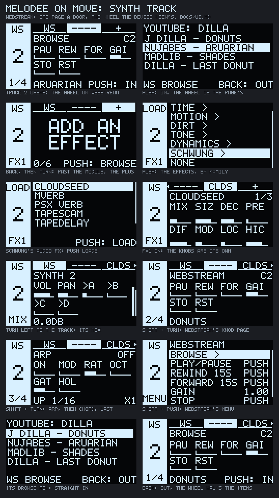 A page asking for text gets the keyboard screen: its title,
the text so far, and the pads lit as keys (letters grey, space blue,
backspace red), the steps as digits.

The jogwheel's push opens the module's menu (`MENU` on the rail), its
levels as lists: the preset first where the level has one, then values
(`CUTOFF      57`), levels (`ENVELOPE >`) and lists to choose from (the
current one marked `*`). Push a value to edit it (`[57]`), push a level to
open it; Back goes up, then closes the menu.

## Tracks

Sixteen tracks, as in Melodee, picked as design **A** (chosen on
2026-11-20). Every Move key keeps the meaning Ableton's manual gives it
(Kerem, 2026-11-20; the whole map is docs/MOVE_CONTROLS.md): Play, Mute,
Shift + Step 5 / 6 / 7, a track button with the Volume knob work as on the
Move, and Melodee's own jobs take keys the Move leaves free (a track button
held with the steps is one). Where a Move job and a Melodee job want the
same key (the track buttons and sixteen tracks, Menu and Load, Loop and
Chop), Kerem decides with that map. `docs/ui/tracks.png` is the sheet
(`src/ui/mockups_tracks.cpp`); the screens are built to it.

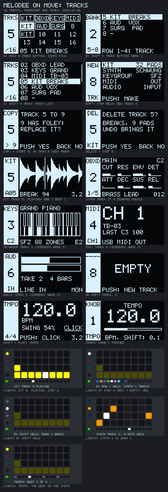

- **The track buttons** are the four tracks of the selected track's bank
  (1-4, 5-8, 9-12, 13-16), each in its track's colour (`ui/track_style.h`),
  the selected one bright, an empty one dark, a muted one grey, a soloed one
  blue (the Move's). A tap picks one. Held with the Volume knob: that
  track's volume in dB (`VOL` / track), as on the Move.
- **Mute**, as on the Move: alone, mutes the selected track; with a track
  button, mutes that track; Shift + Mute + a track button solos it. Its
  light is bright while the selected track is muted.
- **A track button held** shows the sixteen as a grid on the screen, a row a
  bank, each cell the track's kind (a synth's module), the selected one
  inverted; the rail says `TRKS` / the track / `/16`. The 16 steps are the
  sixteen tracks, each in its colour, the selected one white, an empty one
  grey. A step picks its track; an empty step opens the new-track sheet for
  it (shown as the button is let go).
- **Copy held**, with a track button: a step, then another, copies the first
  track onto the second: its sound, kit and patterns; the second keeps its
  mix strip; a synth gets its own instance of the module. Onto a track that
  has something it asks first (`COPY` / from / `> to`): that step again says
  yes, Back or any other step no.
- **Delete held**, with a track button: a step asks to delete that track
  (`DEL`), the step lit red; **the step again says yes** (the Move's Delete +
  pad, the pad again), with Delete and the track button still held or not;
  Back or any other step no. The wheel's push says yes too. Its mix strip
  stays, as Melodee's Delete.
- **The new-track sheet** (`NEW` / track / `TRK`): kit, synth (a Schwung
  module), keygroup, MIDI, audio; the jogwheel picks, push makes it. A kit
  goes on to Load, a synth to its modules. Push on an empty track's screen
  opens it too.
- **Each kind's Play screen**: a kit's (`KIT`) and a synth's (the module's
  short name) as before; a keygroup (`KEYS`), a MIDI track (`MIDI`), an
  audio track (`AUD`) and another host's plug-in (`PLUG`) show what they are
  and play (pads as notes on the note tracks, Up / Down the octave), their
  own pages coming in wave 2 (`docs/PARITY.md`); an empty track (`----`)
  says `PUSH: NEW TRACK`.
- **Transport**: Play plays and stops the patterns, as on the Move; while it
  plays the steps show the selected track's playhead (a sixteenth a step)
  and the detail line the bar and beat (`3.2`). Shift + Play is the Move's
  retrigger, left to the bindings table.
- **The Move's settings on Shift + a step**: with Shift held, Steps 5, 6
  and 7 light (6 white while the metronome is on).
  - **Tempo** (Shift + Step 5): the BPM large; the jogwheel sets it (Shift:
    tenths), knob 1 too; push confirms.
  - **Metronome** (Shift + Step 6): turns it on or off and shows it; the
    jogwheel sets its level (Melodee's: the Move's manual gives none); push
    confirms.
  - **Groove** (Shift + Step 7): the Move's groove, 0 % straight to 100 %
    triplet sixteenths and on to 150 % (Melodee's swing 50 to 75 %); the
    jogwheel sets it; push confirms.
  The steps count the bar's beats on these, the one playing white; Back
  leaves too.

| Screen | Rail | Subject | Detail |
| --- | --- | --- | --- |
| Track button held | `TRKS` / track / `/16` | the sixteen as a grid, a row a bank | track, kind, name; `COPY: A STEP`, `DELETE: A STEP` |
| New track | `NEW` / track / `TRK` | kit, synth, keygroup, MIDI, audio | `PUSH: MAKE` |
| Copy onto a used track | `COPY` / from / `> to` | the question | `STEP YES`, `BACK NO` |
| Delete | `DEL` / track / kind | the question | `STEP YES`, `BACK NO` |
| Empty track | `----` / track | `EMPTY` | `PUSH: NEW TRACK` |
| Keygroup, MIDI, audio, plug-in | `KEYS`, `MIDI`, `AUD`, `PLUG` / track / lowest note or channel | what it plays | kind; the bar and beat while playing |
| Track volume (track button held, Volume knob) | `VOL` / track / `TRK` | the track's volume in dB, a bar | |
| Tempo (Shift + Step 5) | `TMPO` / / signature | BPM large | `PUSH: OK`; bar and beat |
| Metronome (Shift + Step 6) | `MET` | `ON` or `OFF` large, its level | `PUSH: OK` |
| Groove (Shift + Step 7) | `GRV` | the groove in % large | `PUSH: OK` |

## Pads

Two layouts for the 32 pads, the user's choice (Kerem, 2026-11-20; he
approved `docs/ui/pads.png` and took the decisions below the same day):

- **Rows**, the Move's own: eight a row, the bottom row 1-8, then 9-16
  above it, up to 25-32.
- **Banks**, two MPC 4x4 banks side by side: the left bank 1-16 from its
  bottom left (1 2 3 4 / 5 6 7 8 / 9 10 11 12 / 13 14 15 16, bottom to top),
  the right bank 17-32 the same way.

Every pad job follows the one chosen: a pad's number in the layout picks
its job, and its light is lit where that number lies. `src/app/pad_layout.h`
is the map (`logical_pad()`, `physical_pad()`, `pad_layout()`, an atomic the
audio thread reads), arithmetic, no lock. `docs/ui/pads.png` is the sheet
(`src/ui/mockups_pads.cpp`): the setting at the real 128 x 64, then the pads
lit and labelled, Rows on the left and Banks on the right.

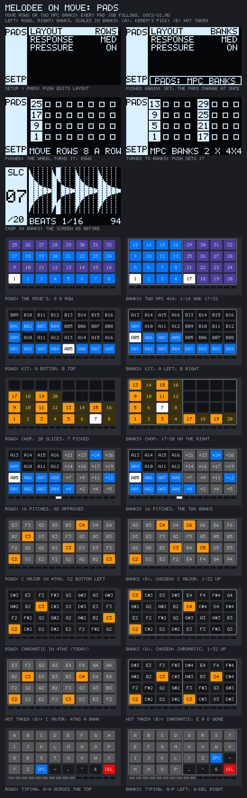

| Job | Rows | Banks |
| --- | --- | --- |
| A kit's 32 pads | bank A the bottom two rows, B the top two | A the left bank, B the right |
| Chop's slices | 1-8 the bottom row, on up | 1-16 the left bank, 17-32 the right |
| 16 Pitches (Shift + Step 8) | the left 4x4 one bank of the kit as the MPC lays it, the right 4x4 the pitches (as approved in controls.png) | the same: exactly the two banks |
| Notes | rows of fourths, C2 bottom left (as before) | 1-32 up the scale, reading (a) below |
| Typing | the keys in reading order across the eight columns | through the left bank, then the right; Delete bottom right in both |
| Session, the Overview | the Move's grids, where the pads lie | the same: they stay physical (Kerem: "Both stay physical") |

Notes in Banks, two readings were drawn; **Kerem chose (a)**:

- **(a)** the 32 pads run up the scale in pad order, 1-16 the left bank,
  17-32 going on in the right, as the MPC's pads run up a scale: In-Key, a
  pad the next note of the key (C major: 32 notes, C2 to F6); Chromatic, a
  semitone a pad (C2 to G4). Every pad a different note, none skipped.
- (b), not taken: rows of fourths inside each 4-wide bank, the right bank an octave
  above the left: In-Key, up a row three notes of the key; Chromatic, up a
  row a fourth, so four columns skip a note each row (E, A, D), and the two
  banks share notes.

In Banks there are no rows, so Keys & Scale's 4ths or octaves is Rows' only.
Up and Down move an octave, Shift + Plus and Minus a note of the key; the
roots light in the track's colour wherever they fall. Chords and Prog put a
pad's chord on its number, Drums plays 36 + the pad's number (as a kit),
note repeat repeats the note the pad pressed. `pad_steps()` in
`pad_layout.h` is the maths: how many steps of the scale a pad lies above
the bottom-left one, `typing_key()` the keyboard.

**The setting** is global: Setup > PADS > LAYOUT (`ROWS` or `BANKS`), kept in
`Move.settings` (`pads 0` or `pads 1`), the same for every track and
project, as it is the hands' and not the song's. No shortcut (Kerem): the
Move has few free keys, and a stray press would move every pad. Push edits
it: the wheel turns it while the screen shows where each run of pads starts
and the pads light their numbering (pad 1 white, the banks or rows in two
colours); push sets it, said on the screen (`PADS: MPC BANKS`), every pad's
job and light changes at once, and the list is back; Back leaves it as it
was. Setup and its PADS list (RESPONSE, PRESSURE, LAYOUT) are
move-projects' (`screens/setup.cpp`, Shift + Step 2); the LAYOUT row opens
`setup-pads` (`src/app/screens/setup_pads.cpp`), the row's words and what
setting it does are `src/app/pad_setting.*`.

| Screen | Rail | Subject | Detail |
| --- | --- | --- | --- |
| Setup > PADS (move-projects') | `PADS` / / `SETP` | the list: `LAYOUT  BANKS` among its rows | |
| Editing LAYOUT (`setup-pads`) | `PADS` / / `SETP` | the 32 pads, each run's first number inverted | `MOVE ROWS 8 A ROW`, `MPC BANKS 2 X 4X4` |
## Kits

Melodee's kits at full depth on the Move (wave 2, kit depth; Kerem's
decisions of 2026-11-20 in [MOVE_CONTROLS.md](MOVE_CONTROLS.md)).
`docs/ui/kit.png` is the sheet (`src/ui/mockups_kit.cpp`), approved before
the screens were built; the screens are `src/app/screens/kit_play.cpp`,
`kit_pages.cpp`, `sample_options.cpp`, `load_kit.cpp`, the lights
`kit_common.h`.


- **128 pads in eight banks** (A-H), as Melodee's kits. The 32 pads are two
  banks, the lower one bottom; **Plus and Minus move them 16 pads** (A-B,
  B-C ... G-H), **Shift + Plus and Minus four** (Control Live's four pads:
  A05-C04), a message naming the pads in view (`PADS C01-D16`), Plus and
  Minus lit where they can move. The bank the view starts in is kept with
  the kit; the four-pad step only for the run. With the Banks pad layout
  (`app/pad_layout.h`) the 32 are two MPC 4x4 banks side by side. The rail's pad (`C05`) carries its
  bank's letter.
- **The pad pages** (Melodee's Stage, the Move's parameter banks): **Shift +
  turn** from Play walks nine pages of the last pad, past either end back to
  Play; Back too. Each page is eight knobs: TRIM (start, end, loop point,
  Loop Lock, gain; a picture of the region with its flags), LAYERS (the
  layer in hand, its velocities, tune, fine, level, pan, how a hit picks; a
  row a layer; the wheel's push loads a sample onto the layer in hand),
  TUNE (tune, fine, Warp, # Beats, and the kit's Follow, its mode Beats,
  Tones or Tape (Tape is Warp's Pitch mode), Pitch), AMP ENV (attack, decay,
  sustain, release, velocity sense, decay from), PLAY (One Shot or Note On,
  Mono or Poly, mute group, offset, Pad Link, loop, reverse, the loop's
  crossfade), CLOUD (on, position, size, density, scan, spread; the cloud
  over the region), MIX (level, pan, kit volume, COLOUR: the track's, one
  of the sixteen track colours, or the pad's own), FILTER (type, cutoff,
  resonance, envelope amount and its four stages) and KIT FILT (the filter
  after every pad: type, cutoff, resonance). A page draws its knobs as
  cells under its title, three letters each; a knob touched shows its full
  name and value large. On a pad holding an instrument (an SFZ, EXS or
  DecentSampler preset, loaded from the kit's Load as a sample is) TRIM
  becomes ZONES, as a keygroup's: the zones over the keys, knob 1 the zone
  in hand, 2 ZONE TUNE (cents), 3 ZONE LEVEL, trimmed on that pad only.
- **Shift + a knob touched** (the Move's second parameter): a kit knob's
  fine view. TUNE shows its cents; START, END and LOOP POINT their value
  over their place close up, 32 times nearer (the Move's Sample Start
  zoom); Shift + turn moves them finely.
- **16 Pitches** (Shift + Step 8, as on the Move): the right 16 pads play the
  last pad up the project's key from its own note (Melodee's 16 Levels
  Scale), pad 1 bottom left; Plus and Minus their octave; the left 16 one
  bank of the kit as the MPC lays it (bottom left first, rows of four), a pad
  there making it the pad the pitches play. The rail says `PTCH`, the
  detail line the key and the octave. The pitches leave from the audio
  thread in the cycle they were read, as any pad.
- **Copy held**, a pad then another: the first's sound (sample, values,
  chain, mute) onto the second; the first blinks while it waits; onto a pad
  that holds a sample it asks first (`COPY` / from / to, push yes, Back no).
- **Delete held + a pad**, at once (Melodee's Erase + pad): its notes in the
  pattern go first; a pad with none is emptied; an empty pad closes its gap,
  the pads after it to the end of the next bank moving down one with their
  notes (`A08-B16 DOWN ONE`).
- **Sample Options** (Shift + push on the pad's sample): CHOP >, REVERSE
  (on or off), TRIM SAMPLE (the region as `Samples/Edits/<NAME>-Trimmed.wav`,
  the pad onto all of it, its values kept), NORMALIZE (the pad's gain, its
  loudest frame to full scale), SAVE SAMPLE (a name typed, then
  `Samples/<name>.wav`). On LAYERS with layer 2-4 in hand they are the
  layer's, and REMOVE LAYER takes it off.
- **The browser** lists bank files (`.mldb`, tagged `BANK`), which load into
  the bank of the pad in view, and MPC drum programs (`.xpm`, `.xty`, tagged
  `KIT`), whose push opens **LOAD KIT**: WHOLE KIT, a row a bank of the kit
  (its push steps through the program's filled banks, then none) and LOAD
  BANKS. **Shift held** in the browser opens its options: Save Sample, Save
  Bank for the two banks in view.
- **Long samples** (over ten seconds, up to six hours, or shorter ones memory
  has no room for) play from storage as Melodee's do (`engine/stream_pager.h`):
  half a second where each pad starts held in memory, the pager reading
  ahead; a long MP3, FLAC, Ogg or AIFF is decoded once into
  `Melodee/Cache` and read from there. The detail line gives a long
  sample's length in minutes. **Memory full**: a load that would leave less
  than 256 MB free is refused, and says so.

| Screen | Rail | Subject | Detail |
| --- | --- | --- | --- |
| Play, banks moved | `KIT` / track / pad | the last pad's waveform | `PADS C01-D16`, for a moment |
| A pad page | `PAD` / pad / page (`3/9`) | the page's title, eight cells; TRIM, LAYERS, CLOUD a picture | TRIM the region's length; LAYERS the layer's velocities and level |
| A knob Shift + touched | `KNOB` / knob / `FINE`, `STRT`, `END` | the value large, or the value over the place close up | the name, `X32` |
| 16 Pitches | `PTCH` / track / pad | the last pad's waveform | key and scale, octave |
| Copy held | `COPY` / pad / `PAD` | the pad, `ONTO A PAD` | the sample |
| Copy onto a used pad | `COPY` / from / to | `REPLACE`, the pad | `PUSH YES`, `BACK NO` |
| Sample Options | `OPT` / pad / `SMP` or `LYR2`-`LYR4` | the list | |
| Load Kit | `KIT` / track / `LOAD` | WHOLE KIT, INTO A-H, LOAD BANKS | |
| Browser options | `OPT` / pad / `LOAD` | Save Sample, Save Bank | |
| Memory full | `KIT` / track / pad | `MEMORY FULL` | |

**Kit lights** (Kerem's rule, 2026-11-20): a pad with a sample dim in its
colour (COLOUR, an MPC kit's own, or the track's), bright while it sounds (the
engine's voice taps); the last pad white; a muted pad dark grey (the Move's dim
white); an empty pad off; a pad waiting (the copy's first, the pad a sample
loads onto) blinks white. With 16 Pitches the right 16 light the key's roots
in the track's colour and its other notes light grey. Copy is bright while
held; Plus and Minus are lit where they move.
## Mixer and effects

Melodee's mix and its 41 effects on the Move's own grammar. The Move has two
audio effects in each Track Preset, after the instrument, and two main
effects in each Set (its manual, chapters 7 and 17.2); the wheel walks the
devices and its push opens the one in focus's browser. Melodee has six
effects on each track, four on each kit pad, four buses A-D with six each
and a return, and six on the master before its compressor (docs/PARITY.md,
mixer & effects). `docs/ui/mixer.png` is the sheet
(`src/ui/mockups_mixer.cpp`, its pieces in `src/ui/mix_widgets.*`),
approved by Kerem on 2026-11-20 with his choices in
[MOVE_CONTROLS.md](MOVE_CONTROLS.md)'s Decisions; the screens are built to
it (`src/app/screens/device_fx.*`, `mixer.cpp`), the logic in
`src/app/mixing.*`, Schwung's effects in `src/app/fx_host.*`.


- **Effects in the Device View.** On Play the wheel walks the track's
  items, three on the row at a time: the track, its sound (a kit's last
  pad, a module's preset), on a kit the pad's own four effects (a dotted
  underline) and their `+`, then the track's six and theirs: each chain
  ends in a `+` while it has room. The knobs
  follow the item in focus, as on the Move: on an effect its six values
  (knob 7 a Compressor's or Gate's KEY: off, a track, a bus); the delays'
  SYNC is one of them, shown as the note value. A bypassed effect is struck
  through.
- **The browser** (the wheel's push on an effect or the `+`): the families
  (Space, Time, Motion, Dirt, Tone, Dynamics) and Schwung's audio effects
  (`/data/UserData/schwung/modules/audio_fx`); in a family each effect loads
  as the wheel turns (the Move's Autoload), push leaves with it; a Schwung
  effect loads on the push. NONE takes the effect out.
- **An effect's options** (Shift + push, as Sample Options on a pad):
  Bypass (the sheet stays, to hear it), Move left, Move right, Copy, Paste,
  Remove. Quicker, on free keys: **Mute held + push** bypasses (Control
  Live's Mute + push deactivates a device), **Delete held + push** removes,
  **Copy held + push** copies, and with Copy still held the wheel walks to
  another slot (any chain's) and a push pastes it. A Schwung effect pasted
  or on a copied track gets its own instance, set as the one copied.
- **The track's mix** (the wheel on the track item): knob 1 its level, 2 its
  pan, 3-6 its sends into buses A-D; its meter on the right; the detail
  line its level in dB and its share of the CPU.
- **The Mixer** (Shift + Step 4): Melodee's MIX hub, its pages on the row
  the wheel walks: VOL, PAN, SNDA-SNDD, MAIN. On VOL, PAN
  and the sends the knobs are eight tracks (Left and Right: 1-8 or 9-16),
  each a strip with its meter, the selected one's number inverted, a muted
  one hollow, a soloed one marked S; a send page shows the bus's return
  last. MAIN: the returns A-D on knobs 1-4, the compressor's reduction and
  the main out. The push opens the page's chain: the selected track's, the
  bus's (its first item the return), the master's (its six, then COMP: the
  compressor with its picture of a bar, knob 7 the sidechain's key track,
  8 its pad). The steps are the sixteen tracks: a step selects one, Mute +
  a step mutes it, Shift + Mute + a step solos it, as with the track
  buttons. A touched knob shows that track large, in dB.
- **Shift + Step 4 again** (Kerem's choice): from the Mixer, Knob FX;
  again Pad FX; again Flex Beat; again the Mixer.
- **Knob FX**: the mode turns on as it opens (the MPC's Knob FX lit) and
  stays on after. The wheel walks the MPC's 28 and Melodee's 15 (`>` before
  one not loaded yet), the push loads it. Knobs 1-6 its values (1-3 the
  setting in hand), knob 7 which setting they edit (A or B), knob 8 slides
  the effect from A to B (the MPC's fader). The steps switch it on for
  tracks, a kit's pads for its pads; Shift + push every track on or off,
  Mute + push bypasses it.
- **Pad FX**: the 32 pads are punches (the MPC's sixteen orange, then
  Melodee's cyan; the wheel, Plus or Minus the other bank), held up to four
  at once (a fifth takes the oldest's place), pressure their depth, played
  from the audio thread in the cycle the pad was read. Knobs 1-3 the last
  MPC punch's own, 4 depth, 5 snap, 6 tail. The bar the pattern plays
  drawn with the punches, kept ones dotted and on the steps; push keeps
  the take in the pattern playing (KEPT), Delete + a pad takes that
  punch's kept ones out; Shift + push its options: latch, master or track,
  quantize, tail.
- **Flex Beat**: pads 1-16, pad 1 Empty; knob 1 One Shot or Loop, knob 2
  its mix, knob 3 quantize.
- **Mute + a kit pad** mutes the pad (dim white), as on the Move;
  **Shift + Mute** alone lets every mute go. **Touching the Volume knob**
  shows the main meter, as the Move's VU meter.
- **The MPC's fader**, which the Move has not: each of its targets is a
  knob where its page is: a track's level on the Mixer and the track item,
  Knob FX's A to B on knob 8, the compressor's amount, Flex Beat's mix.

| Screen | Rail | Subject | Detail |
| --- | --- | --- | --- |
| An effect in the Device View | track kind / track / `FX1`-`FX6`, a pad's `A05` | the row, the effect's name, its knobs | |
| `+` | the same / `FXn` | `ADD AN EFFECT` | slots used, `PUSH: BROWSE` |
| The track item | kind / track / `MIX` | the track's name, its six knobs, its meter | level in dB, CPU share |
| Effect browser | `LOAD` / track / slot | families, then effects | `PUSH: OK` |
| Effect options | `OPT` / track / effect | Bypass, Move, Copy, Paste, Remove | |
| Mixer page | `MIX` / track / `1-8` or `9-16` | the hub row, eight strips | the selected track, its value |
| Mixer MAIN | `MIX` / / `MAIN` | returns, reduction, out | reduction, `PUSH: FX` |
| A bus's chain | `BUS` / `A`-`D` / item | the row, the return or the effect | the tracks sending |
| The master's chain | `MAIN` / / item | the row, an effect or the compressor's bar | its key, the reduction |
| Knob FX | `KFX` / `A` or `B` / `ON`, `OFF`, `BYP` | the effect's name, its knobs | |
| Pad FX | `PFX` / bank / `MST` or `TRK` | the punches held, the bar | quantize, `PUSH: KEEP` |
| Pad FX options | `OPT` / / `PFX` | latch, master or track, quantize, tail | |
| Flex Beat | `FLEX` / pad | the effect large, mode, mix | quantize |
| Volume touched | `OUT` | the out in dB, left and right | the volume |
## Sequencer

Melodee's sequencer on the Move's own keys (Ableton's manual: Step
Sequencing 11, Loop Mode 12, Workflow 13, Recording 14, Capture 14.3,
Session 17), Melodee's patterns underneath (96 ticks a quarter, 128 a
track); its own pages on Shift + Loop, which the Move leaves free (Kerem,
2026-11-20). `docs/ui/sequencer.png` is the sheet
(`src/ui/mockups_sequencer.cpp`, drawn with `src/ui/seq_widgets.*`, which
the screens draw with too); `build/melodee-move --melodee-previews DIR`
draws the real screens into `DIR/sequencer/`.

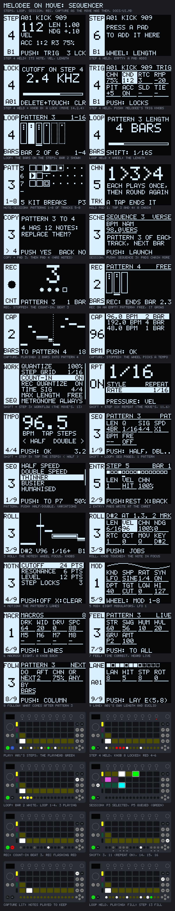

- **The steps** are a bar of the selected pattern (a page of sixteen; twelve
  on a triplet Q), as on the Move: a tap puts the last pad's note on the
  step (a kit: the steps are that pad's lane; a note track: the notes held,
  else the last), a tap again clears it. White with a note, the track's
  colour dim where empty, brighter under a long note, grey past the loop,
  the playhead green. Left / Right the bar (Shift: sixteen bars); a step
  past the end makes the pattern longer (Melodee's spare steps).
- **A step held** shows its card (`STEP` / step / bar): the note, its
  velocity large, its length and nudge in steps, Melodee's marks on it
  (accent, condition, ratchet, chance, slide, tie, locks). Held with the
  Volume knob its velocity, the wheel its length, a later step its length up
  to it, Plus / Minus a semitone (long: an octave; a kit pad's pitch),
  Left / Right a tenth of a step (Shift: a tick; long: a step), a pad that
  pad's note in or out. **A knob** writes a lock of that knob's lane on the
  step (the Move's per-step automation; `LOCK` / step), its range red on
  the steps. **Push** turns the knobs to **TRIG** (Kerem, 2026-11-20):
  chance, condition, ratchet, ramp, pitch ramp, accent, slide, tie; push
  again, back to the locks.
- **Loop** (Loop Mode, `LOOP` / bars / `BARS`): the pattern's bars as
  blocks, the steps its bars (the selected one white, the loop's in the
  track's colour, the bar playing pulsing). A step selects the bar (Note
  Mode's steps show it after), a step held + another the loop between them
  (from bar 1, the pattern's length; from a later bar an editor's loop), a
  double press a one-bar loop; a bar held takes the wheel, the Volume knob,
  Plus / Minus, Left / Right and a pad for its notes; Copy + a bar, then
  another; Delete + a bar. **Loop held + the wheel** is the length (Shift:
  sixteenths) on any screen. **Loop held 0.4 s while playing** is Fill.
- **Note/Session** (Session, `PATT` / pattern / page): a row of pads a track
  of the bank in view (the first on top), a column a pattern number, eight
  at a time (Left / Right; Plus / Minus the bank). Patterns with notes in
  the track's colour dim, playing bright, waiting for the bar green
  (blinking), about to stop blinking in its colour, the selected one
  pulsing white; on the screen the same cells as the pads sit, a follow
  action's arrow, the playing one's progress. A pad launches (the next bar
  while playing, at once stopped); a pad held and others of its row tapped
  chain them; Copy + a pad, then another, asks before replacing; Delete + a
  pad clears it at once (17.1.4). The wheel moves the playhead by Q
  (stopped: Play continues there); its push opens the column's sheet
  (`SCNE`): knob 1 its tempo, knob 2 a ready name, pads of other columns
  chain sequences, push launches. Held, Note/Session peeks.
- **Rec**: from stopped a bar's count-in (`REC` / `CNT`, the beat large,
  Rec flashing), then the take from the top; while playing at once. Notes
  land at the tick the pad was heard (the audio thread stamps it), with Rec
  Quantize on the pattern's Q; overdub; an empty pattern is free and grows a
  bar at a time (`REC` / bars, `FREE`), the take ending at the end of the
  bar playing. Knob turns while recording are written as Motion. Rec again
  or Stop ends the take.
- **Capture** (Melodee's Recall): every track's last phrase into its next
  empty pattern, launched; played stopped, the transport starts and three
  tempos the phrase fits come up (`CAP` / BPM; the wheel picks). Lit while
  there is something to keep; Shift + Capture clears it, as do Play, Stop
  and a track change.
- **Shift + Step 3, Workflow** (`WORK`): quantize amount, step grid (the
  pattern's Q), count-in, Rec Quantize, time signature, a free take's
  longest, the metronome Always or on Rec only, BPM per pattern. **Shift +
  Step 11, Repeat** (`RPT`): Note Repeat on and its screen (style Repeat or
  the arp's Up, Down, Random on a note track; the rate large; pressure as
  velocity), again off. **Shift + Step 14** the next empty pattern, **15**
  twice as long, **16** the Move's Quantize (a tap, Workflow's amount; held
  + a pad, that pad's lane). **Tempo** (Shift + Step 5): the steps tap the
  tempo, Left / Right halve and double it.
- **Shift + Loop, Melodee's SEQ pages** (Shift + the wheel the page; the
  rail names it and says `n/9`): **PATTERN** (length, Q, signature, the
  track's speed, this pattern's BPM, free; push: Half and Double Seq and
  Speed, Thinner, Busier, Humanised, Reversed, an octave up or down into the
  next empty pattern, knob 1 the amount), **ENTRY** (Melodee's Step Edit
  PLAY: pads write at the caret, which moves on as they are let go; the
  wheel the caret, push a rest, Delete back a step), **ROLL** (the notes
  over the bar, the wheel the note in focus; knobs its length, velocity,
  chance, nudge, ratchet, octave, place by Q, key; push the jobs: marks,
  mute, pull to the grid, legato, split, reverse, the arp as notes, loop
  the bar, ramps, insert and delete a step; Copy the marked notes and Copy
  again to paste; Delete erases), **MOTION** (the pattern's lanes; push
  off or on, Delete clears), **MOD** (eight modulators: kind, shape, rate,
  sync, depth, target, its range), **MACROS** (eight, a knob each; push the
  lanes), **FEEL** (Time Correct heard live: strength, swing, humanize,
  velocity, a groove from another pattern, its amount; push lays it on the
  track's others), **FOLLOW** (the follow action; push puts it on the
  column), **LANE** (a kit pad's own lane length; Euclid's hits, steps,
  rotation; push lays it).

| Screen | Rail | Subject | Detail |
| --- | --- | --- | --- |
| A step held | `STEP` / step / bar | the note, velocity large, length, nudge, marks | `PUSH: TRIG`, locks |
| A step held + a knob | `LOCK` / step / pad | the lane's name on the step, its value, a bar | `DELETE+TOUCH: CLR` |
| A step held, TRIG | `TRIG` / step / bar | eight cells: chance, condition, ratchet, ramps, accent, slide, tie | `PUSH: LOCKS` |
| Loop Mode | `LOOP` / bars / `BARS` | the bars as blocks, the loop framed | bar, loop |
| Loop held + wheel | `LOOP` / bars / `BARS` | the length large | `SHIFT: 1/16S` |
| Session | `PATT` / pattern / page | four tracks' eight cells | track, pattern |
| A chain in the making | `CHN` / track / `TRK` | the chain large | `A TAP ENDS IT` |
| A column's sheet | `SCNE` / pattern | tempo, name | `PUSH: LAUNCH` |
| Count-in | `REC`, the dot / `CNT` | the beat large, the beats | pattern |
| A free take | `REC` / bars / `BARS` | the bars growing | bar and beat |
| Capture | `CAP` / bars or BPM | the notes kept, or three tempos | pattern |
| Workflow | `WORK` / / `SEQ` | eight settings | |
| Repeat | `RPT` / `ON` | the rate large, style, rate, pressure | |
| SEQ pages | the page's tag / pattern / `n/9` | a title, eight cells or the page's picture | the push's job |
## MIDI and sync

The Move gives Melodee **one MIDI port**: USB-MIDI cable 2 of its device
page, where a class-compliant device on USB-A and a computer on USB-C (the
"Ableton Move Standalone Port") both arrive, in and out (docs/MIDI.md). So
nothing here picks a port; the rest is Melodee's MIDI as melodee-sample has
it. `docs/ui/midi.png` is the sheet (`src/ui/mockups_midi.cpp`).

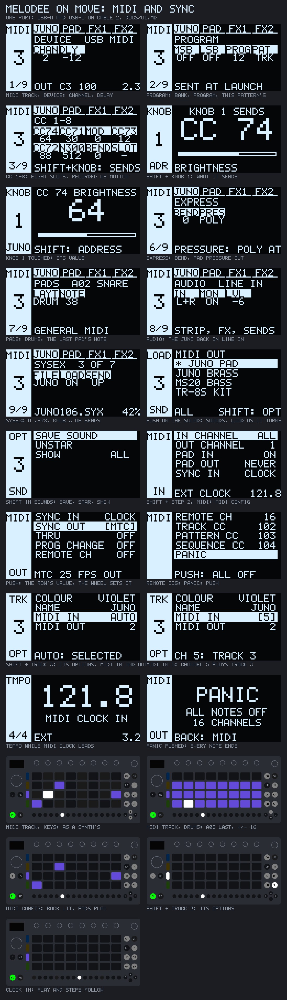

- **A MIDI track's Play screen** (`MIDI` / track / page): the Device View's
  items along the top (the track, its sound, FX1, FX2), the page's title,
  its knobs as names and values (a channel, `POLY`, `-12`: values a bar
  cannot say), the detail line the last message out and the bar and beat.
  Shift + the wheel walks its nine pages, as a module's: **DEVICE**
  (channel, delay in ms), **PROGRAM** (bank MSB and LSB, program, this
  pattern's own), **CC 1-8**, **CC 9-16**, **CC 17-24** (24 slots, recorded
  as motion), **EXPRESS** (bend, how pad pressure goes out), **PADS** (Keys
  or Drums, the last pad's note with its General MIDI name), **AUDIO** (the
  Move's input as the track's sound: L, R or both, monitor, level),
  **SYSEX** (a `.syx` from `Melodee/SysEx`, sent as the project loads; knob
  3 turned up sends it, the detail line counting).
- **What a slot sends**: Shift + a knob on a CC page (the Move's second
  parameter): touched, the knob large says what it sends (`CC 74`, `NRPN
  300`, `BEND`), and turned, changes it (Kerem, 2026-11-20). A touched knob
  without Shift shows its value, under its full name.
- **Sounds** (the wheel's push on the track's sound): the MIDI engine's own
  and the ones saved (`Melodee/Sounds`, `.mlds`), starred ones marked `*`;
  each loads as the wheel turns, push or Back done. Shift held: SAVE SOUND,
  STAR or UNSTAR, SHOW (all, starred, recent).
- **MIDI Config** (Setup, Shift + Step 2: its MIDI and MIDI SYNC rows push it; Back goes back to Setup): in
  and out channels, pad MIDI in and out, sync in and out (MIDI clock or
  MTC), Thru, program change, the Remote channel and CCs, PANIC. The wheel
  picks a row, push edits it (`[MTC]`), the wheel sets it, push again done;
  push on PANIC sends it. The rail's bottom says `IN` and `OUT` as MIDI
  passes; the detail line `EXT CLOCK` and the tempo heard, or `EXT MTC`,
  while following.
- **Track options** (Shift + a track button, as on the Move; move-projects'
  screen, Projects and system below): its colour and name, and the MIDI
  rows: **MIDI IN** (AUTO, or a channel 1-16 that plays this track whichever
  is selected; AUTO: the selected track hears MIDI Config's in channel) and
  **MIDI OUT** (AUTO, or the channel its notes go out on; a MIDI track's is
  its DEVICE channel). Push edits, the wheel turns, push keeps it (an undo
  step), Back leaves it as it was; the detail line says what the row means.
- **Tempo, following MIDI clock**: the BPM heard, `MIDI CLOCK IN`, and `EXT`
  on the detail line; the wheel does nothing then.

| Screen | Rail | Subject | Detail |
| --- | --- | --- | --- |
| MIDI track, a page | `MIDI` / track / page `n/9` | items, the page's title, 8 knob names and values | last message out; bar and beat |
| A slot's address (Shift + knob) | `KNOB` / knob / `ADR` | `KNOB n SENDS`, the address large, a bar | its General MIDI name |
| Sounds | `LOAD` / track / `SND` | the sounds, starred `*` | the filter, `SHIFT: OPT` |
| Sound options (Shift held) | `OPT` / track / `SND` | SAVE SOUND, STAR, SHOW | |
| MIDI Config | `MIDI` / / `IN`, `OUT` | its rows, the one edited `[ ]` | `EXT CLOCK` tempo, `EXT MTC` |
| Panic pushed | `MIDI` / / `OUT` | `PANIC`, what went | `BACK: MIDI` |
| Track options (move-projects') | `TRK` / track / `OPT` | colour, name, MIDI IN, MIDI OUT | on the MIDI rows, what the row means |

Lights: a MIDI track's pads as a synth's on Keys (every C in the track's
colour, a held pad white), as a kit's on Drums (32 pads, Plus and Minus the
next 16, the last pad white); MIDI Config and the track options keep the
pads playing the track and light Back.
## Looper

Melodee's Looper (melodee-sample's `docs/LOOPER.md`) on Shift + Step 12,
where the Move prints no job (Kerem, 2026-11-20): four tempo-synced loops,
L1-L4, each on a loop track of its own (a mix strip and a chain), there
while the Looper is on. `docs/ui/looper.png` is the sheet
(`src/ui/mockups_looper.cpp`); the screens draw with the same pieces
(`src/ui/looper_view.*`), so the screen is the mockup. Kerem chose (the
Decisions in [MOVE_CONTROLS.md](MOVE_CONTROLS.md)): a pad row a loop, Rec
records the selected loop, the screens as drawn.

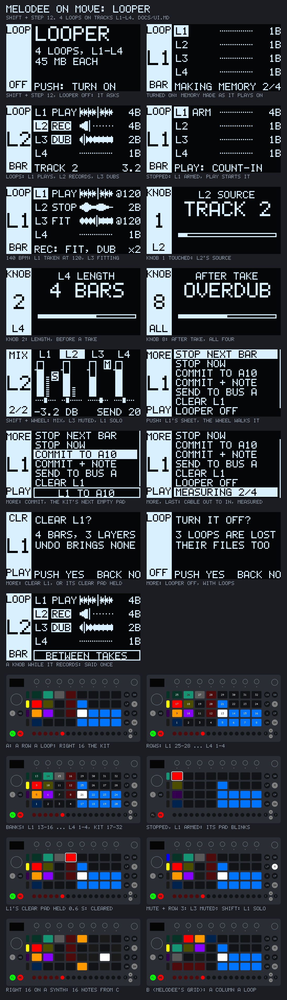

- **Off**, Shift + Step 12 asks first: push turns it on, its memory (45 MB
  a loop) made meanwhile (`MAKING MEMORY n/4`). Shift + Step 12 again, or
  Back, goes back to Play; the loops play on.
- **LOOPS**: the four as rows, L1 on top, as the track buttons and the pad
  rows sit beside them: the tag (the selected one inverted), the state as a
  word (ARM, REC, DUB, PLAY, STOP, FIT; REC and DUB inverted while they
  write, ARM blinking), the waveform with the play head (a set take filling
  as it runs), the length (`4B`, `FREE`; `@120` for one taken at another
  tempo). The detail line: the loop's source, and its layers or the bar and
  beat; `REC: FIT, DUB` on a loop at another tempo; `PLAY: COUNT-IN` while
  one waits, stopped.
- **Knobs** (LOOPS and the sheet): 1 source (Input, Input L, Input R, the
  tracks there are, the other loops, Mix; between takes), 2 length (Free,
  1, 2, 4, 8, 16 bars; before a take), 3 level, 4 feedback, 5 pan, 6 send,
  7 quantize (Bar, Beat, Off), 8 after take (Play, Overdub, Stop); 7 and 8
  are all four's. A touch shows one large (`KNOB` / n / the loop or `ALL`).
- **MIX**, Shift + the wheel: the four strips (fader, meter, pan, M and
  S); knobs 1-4 their levels, 5-8 their pans.
- **Pads**: a row a loop, L1 the top row: record, close, overdub and play
  (as Rec); play or stop on the boundary, again cancels (Shift: at once);
  undo then redo the last overdub; held 0.6 s, clear. The audio thread
  does their jobs in the cycle they were read. The right 16 keep playing
  the selected track: a kit's bank of 16 (the last pad's), A01 bottom
  left; a note track 16 notes up from C. Every pad goes through the pad
  map (`src/app/pad_layout.h`), and in both layouts the loops sit on the
  same pads: in **Rows** L1 is pads 25-28, L2 17-20, L3 9-12, L4 1-4, the
  track's 16 the right half of each row; in **Banks** the left bank is the
  loops (L1 13-16 down to L4 1-4, as the MPC numbers its pads) and the
  right bank, 17-32, the track's 16 (`lights-rows`, `lights-banks` on the
  sheet).
- **Track buttons** are L1-L4: a tap picks the loop; Mute + one mutes it,
  Shift + Mute + one solos it, Mute alone mutes the selected loop; held
  with the Volume knob, its level (`VOL` / `L2` / `LOOP`). Held, they still
  show the sixteen tracks, and a step picks the track the right 16 play.
- **Rec** records the selected loop, as Ableton's Rec records the selected
  track: record, close, overdub, play again; stopped, the take waits for
  Play and starts on its downbeat; a loop at another tempo is fitted to the
  tempo now first (FIT; Rec again cancels), then overdubs.
- **The wheel** picks the loop; **its push** opens the loop's sheet,
  MORE: play or stop on the next bar (or beat, or at once; CANCEL while one
  waits), stop or play now (a take closes on its whole bars), commit to the
  kit's next empty pad (`COMMIT TO A10`; `COMMIT + NOTE` also writes a note
  at bar 1 as long as the loop and stops it), its send's bus, clear (asks),
  Looper off (asks while loops hold audio: their files go too), and **IN
  DELAY**: with a cable from the Move's output into its line in, push
  measures the input's round trip (four clicks) and keeps it. The wheel
  walks the sheet, push does, Back leaves it.
- **Kept** with the project as `Projects/Move Loops/Loop N.wav` (24-bit
  stereo at the loop's rate), written a moment after a loop changes and on
  the way out (while the audio thread still runs); the next start reads
  them back (a loop saved stopped comes back stopped). Commit writes
  `Samples/Looper/L<n> Loop <m>.wav`.
- **Input delay**: a loop recording the input writes it that far behind
  its play head (`loop_latency` in `Move.settings`, device frames; 128, the
  block the runtime adds, until measured). The simulated Move with a
  300-frame cable measures 428, and a take then has its first click at
  frame 3.

Lights: a loop's record pad red recording (blinking armed), orange
overdubbing, the loop's colour dim otherwise; its play / stop pad the
loop's colour playing, white on the bar, dim stopped, blinking with a
change waiting; undo light grey, redo dark grey; clear dim red, red while
held. The track buttons L1-L4 in their colours (mint, yellow, purple, sky),
the selected one bright, an empty one dark grey, muted grey, soloed blue.
The steps: the selected loop across its length, its place white; a take
running, the bar's sixteenths in red. Rec red while a loop records or
overdubs, blinking while one is armed.

| Screen | Rail | Subject | Detail |
| --- | --- | --- | --- |
| Looper off | `LOOP` / / `OFF` | `LOOPER`, four loops, 45 MB each | `PUSH: TURN ON` |
| Loops | `LOOP` / loop / quantize | the four as rows | source; layers or bar and beat |
| Mix | `MIX` / loop / `2/2` | the four strips | level in dB, send |
| A knob touched | `KNOB` / n / loop or `ALL` | name, value, bar | |
| The loop's sheet | `MORE` / loop / state | its jobs as a list | |
| Clear | `CLR` / loop / state | the question | `PUSH YES`, `BACK NO` |
| Looper off, loops held | `LOOP` / / `OFF` | the question | `PUSH YES`, `BACK NO` |
| A loop's volume | `VOL` / loop / `LOOP` | its level in dB, a bar | |

## Projects and system

Projects, Setup, undo, naming and a track's options, as the Move has them
(Shift + Step 1, Shift + Step 2, Undo, Shift + a track button) and Kerem
chose (docs/MOVE_CONTROLS.md, Decisions). `docs/ui/projects.png` is the
sheet (`src/ui/mockups_projects.cpp`); the screens draw with the same code
(`src/ui/system_draw.*`), so each is its mockup.

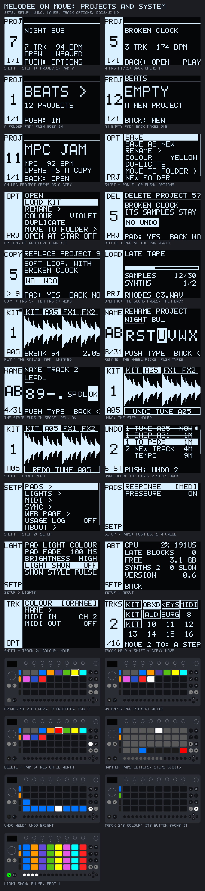

- **Projects** (Shift + Step 1, the Move's Set Overview): a folder's
  projects on the 32 pads, the top row first, each in its colour, folders
  grey, the one picked pulsing, an empty pad white when picked. A project
  keeps its pad (the folder's `.move-pads`); one put there from elsewhere
  takes the first free pad; Plus and Minus page through 32 at a time. The
  screen names the pad's project large, its tracks and tempo, OPEN on the
  one open (UNSAVED while it has changes), AT START on the one opened at
  start. A pad picks; **Back or a track button opens it** (the sound fades,
  the audio thread waits while it is built, the Loading sheet counts its
  samples and synths, the sound comes back); an empty pad, then Back, makes
  a new project there; Play opens the one picked and plays it (the Move's
  preview). The wheel walks the pads. A folder's push goes in, Back comes
  out. MPC projects (`.xpj`) open as a copy, saved as a `.mldp` beside it.
- **Options** (the wheel's push, or Shift + a pad): the open project's SAVE
  (the sample slots nothing plays freed), SAVE AS NEW, RENAME, COLOUR,
  DUPLICATE, MOVE TO FOLDER, NEW FOLDER, OPEN AT START; another's OPEN,
  LOAD KIT (its first kit onto the selected track, its patterns left: one
  undo), RENAME, COLOUR, DUPLICATE, MOVE TO FOLDER, OPEN AT START, DELETE.
- **Copy and Delete**, as the Move: Copy + a pad, then a pad copies it
  there (asking before it replaces one, the pad again says yes); Delete + a
  pad asks, the pad again deletes (Delete alone asks for the one picked).
- **The question** before a loss (Melodee's one sheet): what is asked, one
  or two lines of what goes, a chip saying whether undo brings it back
  (`UNDO BRINGS BACK`, or `NO UNDO` inverted), push yes, Back no; a touch
  (the wheel's, a knob's) answers nothing, so a hand off and back on leaves
  it asked. Deleting
  or replacing a track, a project, or a synth's module all ask here.
- **Undo**: Undo takes the last step back and says which (`UNDO TUNE A05`),
  Shift + Undo redoes. **Undo held** opens the undo list: the steps
  undone, then the steps done, newest first, each with its track and age,
  then START; the cursor opens on the state in hand (a notch at its right),
  the rows above it struck through (undone once it is reached); the wheel
  or Plus / Minus move it, a push goes there, Back closes it.
- **UNSAVED**: a black mark in the rail's top right corner while the
  project has changes not saved yet (autosave takes it away).
- **The name sheet** (rename, save as new, a track's name, a module page's
  text): the Move's own typing. The wheel walks a strip of characters (the
  one in the box inverted), its push types it; the strip ends with SP, DL
  and OK. The pads type letters at once (letters grey, space blue, delete
  red), the steps digits; Back deletes, held cancels; Shift is upper case.
  The rail says `NAME`, the case, and how much of the room the name takes.
- **Setup** (Shift + Step 2): PADS (response soft, medium, hard, full;
  pressure), LIGHTS (pad lights colour, white, off; pad fade; brightness
  low to max, as the Move's; the light show and its style: Pulse, Sweep,
  Chase, Ripple, Levels, in time with the tempo), MIDI and SYNC (move-midi),
  WEB PAGE (move-web), USAGE LOG, ABOUT (the audio cycle's share and
  longest, late exchanges, room left, synths and their slow calls, the
  build), BACK TO MOVE. No FEATURES (Basic or Full): the Move is always
  Full (Kerem, 2026-11-20). A push opens a door or edits a value
  (`[MED]`: the wheel turns it, a push keeps it, Back leaves it as it was);
  a value of two flips at once. Step 2 flashes while it is open.
- **A track's options** (Shift + a track button): its COLOUR (the wheel
  turns it, the track button and the pads showing it as it turns) and its
  NAME; move-midi adds its MIDI channels. Both are undo steps.

| Screen | Rail | Subject | Detail |
| --- | --- | --- | --- |
| Projects | `PROJ` / pad / page | the folder; the project's name large, tracks and tempo, OPEN, UNSAVED | `BACK: OPEN` `PLAY`; `PUSH: OPTIONS`; `PUSH: IN`; `BACK: NEW` |
| Options | `OPT` / / `PRJ` or `FLDR` | the rows | |
| Question | the verb / the number / what | the question, what goes, the undo chip | `PUSH YES` or `PAD: YES`, `BACK NO` |
| Loading | `LOAD` / / `PRJ` | the name, a bar, samples and synths read | the file being read |
| Undo list | `UNDO` / steps to go / steps kept | the steps, the state in hand marked | `PUSH: UNDO 2`, `PUSH: REDO 1` |
| Name sheet | `NAME` / case / length | the title, the name and its room, the strip | `PUSH TYPE`, `BACK <` |
| Setup | `SETP`, `PADS`, `LGHT` | the rows, values at the right | |
| About | `ABT` / / `SETP` | CPU, late, free, synths, version | `BACK` |
| Track options | `TRK` / track / `OPT` | COLOUR, NAME (and MIDI) | |

Lights: the projects on the pads (above); the question's pad red, the rest
dark; the name sheet's keys; Undo bright on the undo list; Setup's Step 2
flashing; a track's colour on its button as it is turned. Setup's
brightness dims every light as it is sent (`move::Lights::set_brightness`);
its pad lights and the light show draw over a Play screen's pads.

## Song

Melodee's arrange view (Shift + Step 13; the Move has no song view, so its
controls take Session's and Loop Mode's meanings where they have one), its
exports, and print and freeze, picked as drawn on 2026-11-20 with Kerem's
doors (docs/MOVE_CONTROLS.md, Decisions). `docs/ui/song.png` is the sheet
(`src/ui/mockups_song.cpp`); the screens are built to it, drawn by the same
`ui::song_view()` (`src/ui/song_view.*`).

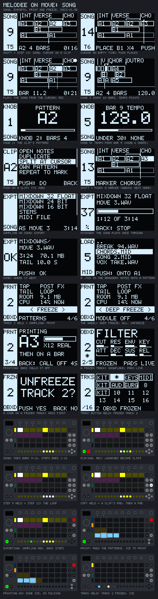

- **Song** (`SONG` / the cursor's bar / the lane's track): a row of
  markers, the loop brace under it, then four lanes, the tracks of the bank
  in view (the track buttons' four), time left to right. A clip is a box
  with its pattern's name (A1 .. H16), the one under the cursor filled, a
  muted one dotted; an empty track's lane a dotted line; the selected lane
  marked at its left. The cursor is a line down the lanes, the playhead a
  dotted one; tempo points are notches over the brace. Knob 3 zooms (4 to 64
  bars across). The detail line: the clip under the cursor (`A2 4 BARS`),
  or what a push places (`PLACE A1 X4`), a marker's name on its bar, the bar
  and beat while playing; on the right the clock at the cursor, or with a
  tempo lane its tempo there.
- **The pads** are the four lanes over eight bars (as Session lays clips
  out, a row a track): a clip's first bar bright in its track's colour, the
  rest dim, a muted clip grey, the cursor white, the playhead's bar green. A
  pad moves the cursor there (and selects that lane's track); Copy held, a
  clip's pad then another copies it there; Delete held deletes it; Mute held
  mutes it. **The steps** are sixteen bars (as Loop Mode has them): the
  loop's bright, the lane's clips dim, the cursor white; a step moves the
  cursor, a step held and another sets the loop brace. Song's pads are a
  grid of where they lie, as Session's, in both pad layouts; PRINT's
  patterns are numbered pads and follow Rows or Banks.
- **The wheel** moves the cursor a bar; its push on a clip opens its jobs
  (`CLIP`: open notes, duplicate, split at the cursor, own pattern, repeat to
  the next marker, loop its bars, mute, delete), on empty time places the
  pattern and length on knobs 1 and 2. Shift + push adds a marker, or on one
  steps its name. **Copy** duplicates the clip after itself, **Delete**
  deletes it, **Loop** puts the brace on its bars (again: off).
  **Plus / Minus** move the bank of lanes, **Left / Right** the pads' page
  of eight bars, **Shift + Left / Right** jump to the markers.
- **Play** plays the song from the cursor (Shift + Play: again from it);
  **Rec** writes launches into it as clips, a bar at a time. Knob 5 sets the
  cursor's bar's tempo (under 30 BPM: none there), knob 6 its shape (Step,
  Ramp). A track button leaves for Play, as on the Move.
- **EXPORT** (Sampling on Song; the Move's Resampling records its whole
  output): MIXDOWN 32 FLOAT, 24 BIT, 16 BIT, STEMS, MIDI FILE, MPC 3
  PROJECT, ABLETON LIVE SET, SONG TO PATTERN; the wheel picks, push exports,
  named after the project. A mixdown or stems play the song once through:
  the screen shows how far (`37 %`, the clock, the tail), Sampling red; Back
  or Play stops it and drops the files. Then where it went (`MIXDOWNS/`,
  `MOVE 3.WAV`, its length and size); push goes back. Under
  `/data/UserData/Melodee`:
  `Mixdowns/`, `Stems/<name>/`, `MIDI/`, `MPC 3/`, as on the MPC's card,
  and `Ableton/<name> Project/`: a Live Set (Live 12.1 or later) to go on
  with the project in Live, its samples and prints copied beside it. The web
  page downloads that folder as a zip. Each pattern is a Session View clip
  in the scene of its number, the song is laid out in Arrangement View, a kit
  is a Drum Rack of Simplers, a keygroup track a Simpler (an SFZ of zones a
  Sampler), a synth track its notes on a MIDI track and its prints on an
  audio track beside it; levels, pans, mutes, sends (the buses as return
  tracks), tempo, scenes' tempos, markers and the loop brace go with it.
  Effects, Motion and pad filters do not (src/app/live_export.h).
- **PRINT** (a track button held + Sampling): the track's patterns on the
  pads (Plus / Minus: 32 a bank), with notes dim in its colour, to print
  ice, the one playing blinking; a pad takes one out or back. TAP (knob 1),
  TAIL (knob 2), the room the prints take and the share of a block the track
  takes now; the wheel picks FREEZE, DEEP FREEZE, ALL, NONE or UNFREEZE (on
  a frozen track), push does it. While printing: the pattern large, how
  far, its speed against real time, `THEN ON A BAR`; the pads done ice, the
  one printing blinking; Back calls it off.
- **A frozen track**: a snowflake in its Play screen's rail and in its cell
  of the sixteen (its step ice); its pads still play live. A knob, a step,
  its browser or menu asks first: `UNFREEZE TRACK 2?`, push yes, Back no.

| Screen | Rail | Subject | Detail |
| --- | --- | --- | --- |
| Song | `SONG` / cursor bar / `T5` | markers, brace, four lanes, cursor | clip or `PLACE A1 X4`, clock or tempo |
| A clip's jobs | `CLIP` / pattern / track | the list | `PUSH: DO`, `BACK` |
| A knob on Song | `KNOB` / knob / `SONG` | `PATTERN`, `BARS`, `ZOOM`, `BAR 9 TEMPO`, `SHAPE` | |
| EXPORT | `EXPT` / / `SONG` | the kinds | `AS MOVE 3`, the song's length |
| Exporting | `EXPT` / percent / `%` | kind, file, progress, clock | `BACK: STOP` |
| Exported | `EXPT` / `OK` | folder, file, length and size, tail | `PUSH: OK` |
| PRINT | `PRNT` / track / module | TAP, TAIL, ROOM, CPU, the action | `PATTERNS`, chosen / with notes |
| Printing | `PRNT` / track / n of m | the pattern, progress, speed | `BACK: CALL OFF`, time left |
| Unfreeze | `FRZN` / track / module | `UNFREEZE TRACK N?` | `PUSH YES`, `BACK NO` |

## Sampling

Melodee's sampling on the Move, approved by Kerem on 2026-11-20 as
`docs/ui/sampling.png` draws it (`src/ui/mockups_sampling.cpp`), built on
the approved Sampling and Audio Recall cards of `controls.png` and Record of
`rail.png`. The Move's **Sampling** button is Melodee's Sample Record, and
the Move's keys keep their meaning ([MOVE_CONTROLS.md](MOVE_CONTROLS.md),
Decisions).

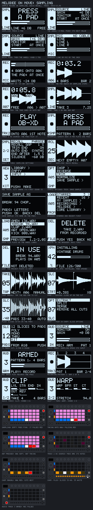

- **Sampling** (a kit track): `SMPL`, the record light, `PRESS A PAD`
  large, the input's level left over right, the source and gain under it.
  Press a pad to record onto it: at once, or once the input passes START's
  threshold, or with LENGTH SEQ where the pattern comes round. The pad again,
  Sampling, the wheel's push or Play stopping ends the take; a pad held 0.4 s
  ends it as it is let go; another pad carries the take on onto that pad
  (one file, a part a pad). Back leaves, keeping a take.
- **The input**: the wheel walks SOURCE, GAIN, MONITOR, START, LENGTH (and
  TAP for a track) as the Move's walks gain, monitoring and source; its push
  steps the row on (GAIN and START: push, then the wheel); knobs 1-6 set
  them. The Move's one input is the mic or the line in as its jack says:
  SOURCE offers MIC, or LINE, LINE L, LINE R, then RESAMPLE (Melodee's mix)
  and each TRACK with a sound. With Melodee's own sound as the source the
  pad pressed is the take's, and from then the pads play the source.
  Shift + the wheel: the SAMPLING settings (Recall's cut, a Free take's own
  end, the browser's preview).
- **Audio Recall** (Shift + Sampling): the last 25 s onto the next empty
  pad, at once; `RCL` shows what it kept for a moment.
- **The pads**: the empty ones pink, the kit's in its colour (they can be
  recorded over), the one taking pulsing red, the parts taken red.
  Sampling is red in Sampling Mode, pulsing while it records.
- Takes go to `Melodee/Samples/Recorded` as `TAKE n.wav` (`RESAMPLE n`,
  `RECALL n`), written as they are recorded.

The rest of the sheet: the new-track sheet's KIT asks where its first sound
comes from (LIBRARY, EMPTY, INPUT); Sample Options' TRIM and SAVE SAMPLE (its
name typed on the pads); the browser leads with STARRED and RECENT, plays
each file as the wheel lands, stars on Shift + push, deletes on Delete
(asked; what the project plays is kept), installs an MPC expansion on push;
Chop's manual take (the red pad cuts next), a cut close up while knob 1 or
2 turns, slices 33-64 on Plus and Minus, slice options on Shift + push, To
Pads KIT; an audio track's INPUT on Sampling, Rec arming it, its take's CLIP
and WARP pages.

| Screen | Rail | Subject | Detail |
| --- | --- | --- | --- |
| Sampling | `SMPL`, the record light / source | `PRESS A PAD`, the level | source and gain, length |
| The input's rows | `SMPL` / source | SOURCE, GAIN, MONITOR, START, LENGTH, the level | |
| Armed | `REC`, the record light / source | the level and threshold, length onto the pad | `WAITS -24 DB` or `NEXT LOOP` |
| Taking | `REC`, the record light / pad | the time, the take growing, its parts | length, bar or `A06 > A07` |
| Taken | `SMPL` / source | the take, its parts | name, seconds |
| Sampling settings | `SMPL` / `2/2` / `SET` | Recall, gap, trim end, auto end, after, silence, preview | |
| Audio Recall | `RCL` / `25` / `SEC` | what it kept | `NEXT EMPTY: A07` |

## Instruments

Melodee's instruments on the note tracks (wave 2, `docs/PARITY.md`,
instruments): keygroup tracks, the Move's Keys & Scale with Melodee's own
layouts, the ARP and CHORD pages, a module track's macros, and the auto
sampler. `docs/ui/instruments.png` is the sheet
(`src/ui/mockups_instruments.cpp`); the screens are built to it once Kerem
has approved it. The Move's keys keep Ableton's meaning: Shift + Step 9 is
Keys & Scale, Shift + Step 10 Full Velocity, Shift + Step 11 Repeat and
Arp, Plus and Minus the octave, Shift + Plus / Minus a scale degree
(Control Live's job, free on the Move).

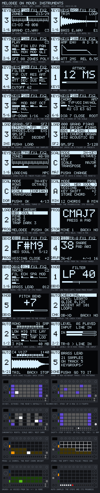

- **A keygroup track** plays one instrument across the pads: an SFZ, an
  MPC keygroup program (`.xpm`, MPC 3's `.xty`), an EXS24 instrument, a
  SoundFont preset, a DecentSampler preset, or one sample, played from the
  note found in it. Its Play screen is the Device View: the wheel walks the
  track, its instrument and its effects; the push on the instrument opens
  the instrument browser (instruments and samples; a SoundFont opens as a
  folder of its presets). Its zones stream from storage and play as their
  files land (`LOADING` and a bar on ZONES).
- **Its pages**, Shift + turn, knobs 1-8: **ZONES** (an instrument: knob 1
  picks a zone, 2 its tune, 3 its level; the zones drawn over the keys) or
  **TRIM** (one sample: start, end, loop, loop point, crossfade, reverse,
  the waveform), **PLAY** (tune, fine, level, pan, velocity, mono, play
  mode, glide), **AMP ENV** (attack, decay, sustain, release; the shape
  drawn), **FILTER** (type, cutoff, resonance, envelope amount, and the
  filter envelope's four stages), then **ARP** and **CHORD**. Melodee's
  TUNE and FILT ENV pages fold into PLAY and FILTER: the Move has eight
  knobs where the MPC has three.
- **ARP** (every note track's page): on, mode (Up, Down, Up-down, Random,
  Order), rate (1/4 to 1/64T), octaves, gate, hold. Shift + Step 11 opens
  the Move's Repeat and Arp, whose Arp styles turn the same arpeggiator on.
- **CHORD** (every note track's page): on, type (Triad, Dia 7, Sus2, Sus4,
  Power, Dia 9), voicing (Close, Open, Drop 2, Spread), inversion, hold;
  the last chord drawn on two octaves of keys.
- **Keys & Scale** (Shift + Step 9), the Move's list: MODE (the Move's
  In-Key and Chromatic, then Melodee's Prog and Drums), ROWS (Octaves or
  4ths), KEY, SCALE (Melodee's thirteen, which the project file keeps), and
  TRANSPOSE (-12 to +12). The key and scale are the project's, set from any
  track; the mode, rows and transpose are each track's. Push a row to change
  it, the wheel turns it, push again is done.
- **Prog**: each pad a chord of an MPC 3 `.progression`; the PROG row's push
  lists the progressions (loaded as the wheel turns), VOICING (File, Close,
  Open, Spread) and KEY SHIFT move them. The rail names the chord played.
- **The chord builder**: STORE CHORD with pads held takes their notes; the
  mode turns to Prog, the empty pads pulse, and the pad pressed next takes
  the chord, saved as `Mine N` in `Melodee/Progressions`.
- **Drums**: the pads play notes 36 up as a kit's do (pad 1 is 36), Plus and
  Minus move 16; the screen names the voice hit (a MIDI drum map's or
  General MIDI's name).
- **Full Velocity** (Shift + Step 10): every pad at 127, as on the Move; its
  step lights bright while Shift is held.
- **A module track's knobs are the module's own**: a track opens on the
  module's first page (Webstream's and Radio Garden's Browse, where they ask
  for it first); ARP and CHORD follow its pages. Melodee's FILTER, ECHO and
  SPACE macros are not on the Move (Kerem, 2026-11-20: Schwung's controls
  take the knobs); a project's are let go as it opens.
- **Auto sample**: a module track (or a MIDI track's instrument, heard at
  the line in) played a key at a time into an MPC keygroup program on a new
  keygroup track. The check runs first (CHECKING, then what it found);
  knobs 1-8 are LOW, HIGH, STEP, LAYERS, HOLD, TAIL, TAP, LOOP, Shift + turn
  the second page (LEVEL; on a MIDI track the INPUT and its meter); push
  starts, the steps fill as the keys are done, Back stops and deletes what
  was made.

| Screen | Rail | Subject | Detail |
| --- | --- | --- | --- |
| Keygroup, a page | `KEYS` / track / page | the items, the page's title, its knobs or picture | the zone or sample, the note |
| Instrument browser | `LOAD` / track / `INS` or `SF2` | instruments and samples, a SoundFont's presets | `PUSH: LOAD` |
| ARP, CHORD | the track's / track / page | six or five knobs; CHORD's keys | mode and rate; type and voicing |
| Keys & Scale | `SCAL` / key / scale | MODE, ROWS, KEY, SCALE, TRANSPOSE (Prog: PROG, VOICING, KEY SHIFT, STORE CHORD) | `PUSH: CHANGE` |
| Progressions | `LOAD` / track / `PROG` | the progressions | `PUSH: OK` |
| Store a chord | `PROG` / / `STOR` | the chord's name large | `BACK: NO` |
| Drums | the track's / track / `DRUM` | the note and its voice | `36-67` |
| Auto sample | `AUTO` / track / page or progress | the keys to sample, eight knobs, the note recorded | samples, time, room |

## Screens in code

Each screen is a file of its own in `src/app/screens/`, a `Screen`
(`src/app/screen.h`) registered there with a `RegisterScreen`: its id, how
it is made, the jobs of the bindings table that open it (a `Trigger`:
`Job::Tempo`, Shift + Step 5, opens `tempo`), or the track kinds whose Play
screen it is. A screen answers jobs, never buttons; the app runs every
control through the bindings table ([MOVE_CONTROLS.md](MOVE_CONTROLS.md),
"How the app runs the map") and keeps the jobs that are the same
everywhere: the track buttons and the sixteen tracks, transport, the
Volume knob, mute and solo, a touched knob shown large, typing for a
module's page. A new screen is a new file; no other file changes. What the screens share is the studio
(`src/app/studio.h`): Melodee's project and engine host, samples, modules,
transport, saving.

## Controls

As on the Move, by the rule above; [MOVE_CONTROLS.md](MOVE_CONTROLS.md)
has every control and shortcut, where each one stands, and the tests that
hold the code to it. In short:

| Control | Does |
| --- | --- |
| Pads | Play: a kit's 32 pads (two of its eight banks of 16; with 16 Pitches, one bank and the last pad's pitches), a module's notes; Chop: its slices; with a step held, notes on the step; Session: patterns |
| Steps | Step Edit (a pattern's sixteenths; in Loop Mode its bars); held with a pad, the volume knob, the wheel, Plus/Minus or Left/Right, that step's notes |
| Shift + steps | 1 projects, 2 Setup, 3 Workflow, **4 Mixer**, 5 Tempo, 6 metronome, 7 swing, 8 16 Pitches, 9 Keys & Scales, 10 Full Level, 11 Repeat and Arp, **12 Looper**, **13 Song**, 14 a new pattern, 15 double, 16 Time Correct (Melodee's own in bold). Shift held lights them; the screen shows nothing |
| Track buttons | the four tracks of the bank in view; held, the sixteen, and a step picks one (Tracks, above); Shift + one, its options |
| Knobs 1-8 | the screen's eight parameters; touch one to see it large; Shift for fine |
| Volume knob | the main volume; with a pad held its level, a track button its level, a step its velocity |
| Wheel | on Play, turn to walk the track's items (the track, its sound, its effects) and push to open that item's browser; Shift + turn the pages; Shift + push Sample Options (Chop) or a module's menu; in lists, turn and push |
| Note/Session | Play or the Patterns grid; Shift + it, the 16 tracks |
| Play / Shift + Play | start and stop / restart every pattern |
| Rec | Seq Record |
| Capture / Shift + Capture | Recall the notes just played / clear them |
| Sampling / Shift + Sampling | Record onto a pad / Audio Recall onto the next empty pad; on Song, EXPORT; a track button held + Sampling, PRINT |
| Loop | Loop Mode; held with the wheel, the pattern's length |
| Mute | the selected track; held with a track or a pad, mutes it; Shift + Mute + track solos |
| Undo / Shift + Undo / held | undo / redo / the undo list |
| Copy, Delete | the pattern, or held with a step, pad or track what it names |
| Plus / Minus | a synth's octave, a kit's 16 pads; with a step held, transpose |
| Left / Right | the pattern's bar; in Chop, the slice |
| Back | out a level; held, back to Play; Shift + Back, back to Ableton's Move app |

## Lights

- **Pads, either layout**: each lit where its number lies in the layout
  chosen ("Pads", above); while LAYOUT is edited, the numbering itself.
- **Pads**: a kit in its pads' colours, the last hit white; in Chop the
  slices in alternating colours, the selected one white, and in a manual take
  the pad that cuts next blinking red; on a note track (a module, a
  keygroup, MIDI) the key's roots in the track's colour, its other notes
  light grey, the rest dark, a held pad white, as the Move's Keys & Scale
  ("Instruments", above).
- **Steps**: in Chop, the parts where a cut falls; on Play the pattern's
  bar (white notes, the track's colour dim where empty, brighter under a
  long note, grey past the loop, the playhead green, a held step's locks
  red); in Loop Mode its bars.
- **Track buttons**: the bank's four, each its track's colour, dim; the
  selected one bright; an empty one dark.
- **Steps, a track button held**: the sixteen tracks, each its colour, the
  selected one white, an empty one grey; Copy and Delete lit.
- **Steps, Shift held**: Steps 5, 6, 7 (tempo, metronome, groove), 6 white
  while the metronome is on.
- **Steps, on tempo, metronome and groove**: the bar's beats, the one
  playing white.
- **Track buttons, muted and soloed**: grey and blue, as on the Move.
- **Mute**: bright while the selected track is muted.
- **Play**: green while playing.
- **Knob lights**: lit for the knobs the screen uses, dark for the rest.
- **Buttons**: lit where they do something on this screen.

## The web page

Melodee's web page (`src/web/`, [GUIDE.md](GUIDE.md), "The web page") at
**http://move.local:8080** has three tabs: **Screen**, the Move's screen
live, as the MPC's USB webcam shows the MPC's; **Files**, Melodee's folder
(`/data/UserData/Melodee`); **Guide**, the Move's controls. On the Move it
adds the screens below, drawn by the web layer over whatever the app shows
(`src/web/screens.*`); `docs/ui/web.png` is the sheet.

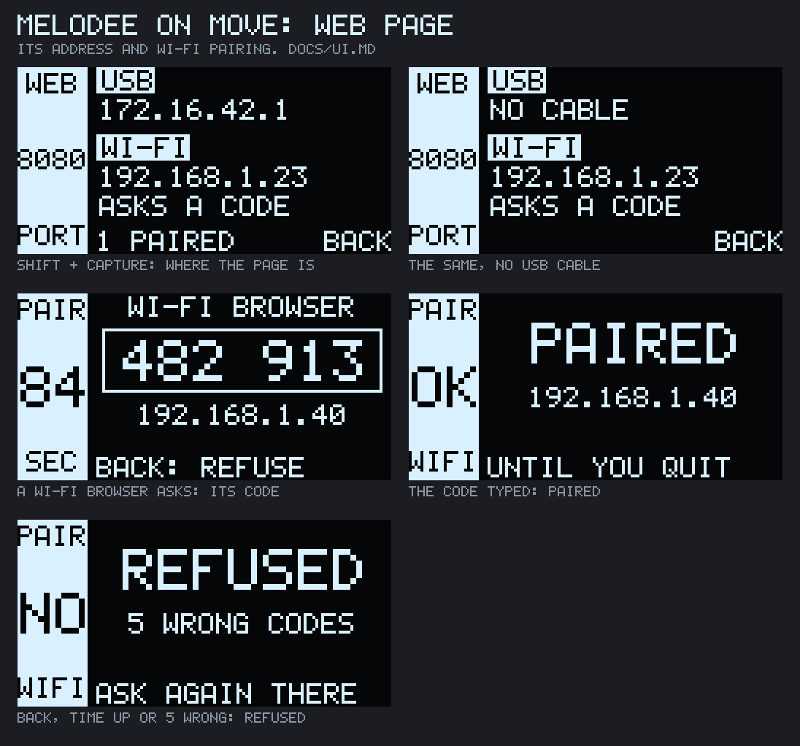

| Screen | Rail | Subject | Detail |
| --- | --- | --- | --- |
| Where the page is (Shift + Capture) | `WEB` / port / `PORT` | the USB address, the Wi-Fi address (`NO CABLE`, `NOT JOINED`) | browsers paired, `BACK` |
| A Wi-Fi browser's code | `PAIR` / seconds left / `SEC` | the six digits large, the browser's address | `BACK: REFUSE` |
| Paired | `PAIR` / `OK` / `WIFI` | `PAIRED`, the browser's address | `UNTIL YOU QUIT` |
| Refused | `PAIR` / `NO` / `WIFI` | `REFUSED`, why: Back, time up, five wrong codes | `ASK AGAIN THERE` |

Who may use the page, as Kerem chose on 2026-11-20: a browser on the USB
cable at once (it came in on the `usb*` interface's address, from that
network); any other only after typing the code the Move shows, until
melodee-move stops. The code shows 90 seconds; five wrong tries or Back
refuse it, and that browser may not ask again for five minutes, so a device
on the Wi-Fi cannot keep taking the screen and buttons with codes. While the address or a code shows, the buttons and the jogwheel
are the sheet's (Back closes or refuses); pads, steps and knobs still play.
Paired and Refused show three seconds and take nothing.

Shift + Capture is taken because the other sessions' proposals use Shift +
Menu (a track list) and Shift + Play (tempo); it can move once those settle.

## Open questions

- ~~The pad pages' exact contents.~~ Settled with kit depth: nine pages on
  Shift + turn ("Kits", above).
- A module track's note layout: settled, the Move's Keys & Scale
  ("Instruments"); in the pads' two MPC Banks, In-Key and Chromatic run up
  in pad order, 1-16 then 17-32 (Kerem's reading (a), `pad_layout.h`).
- Realtime priority when Schwung launches melodee-move as `ableton`: a
  small root helper, as EvilGenius uses, or not.
