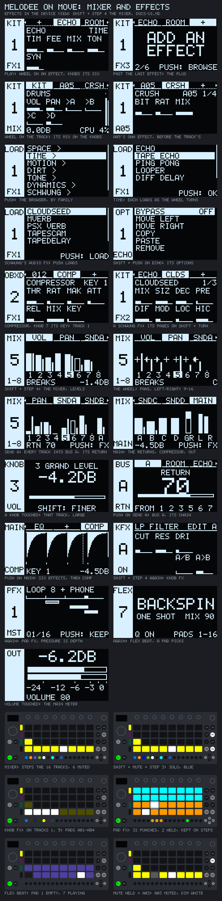

# Melodee on the Move: the interface

The design is **Rail**, chosen from three directions (Panel, Full Bleed,
Rail) on 2026-11-20. The first scope is Melodee's sampler, Chop, and loading
Schwung's modules as instruments and effects; then sixteen tracks,
transport and tempo ("Tracks", below). The screens are mockups first, drawn
by the UI kit (`src/ui/widgets.*`) at the screen's real size, each set in a
file of its own (`src/ui/mockups*.cpp`); the app's screens are built to
them. `build/melodee-move --ui-mockups DIR` renders them again
(`docs/ui/rail.png`, `docs/ui/tracks.png`); `--melodee-previews DIR` draws
the app's own screens.


## Principles

- **Big and focused.** One subject a screen and one number that matters,
  large. A knob's detail shows when it is touched, not all the time.
- **The rail answers "where am I"**, on every screen, in the same place.
- **The pads, steps and lights carry as much as the screen.** The screen
  never repeats what the pads already show.
- **The Move's controls keep Ableton's meaning** (Kerem, 2026-11-20). Every
  key and shortcut does what Ableton's Move manual says it does: Loop is
  Loop Mode, Note/Session switches Play and the Patterns grid, Shift + Step 5
  is Tempo. Melodee's own jobs take the controls the Move leaves free
  (Shift + push for Chop, Shift + Sampling for Audio Recall, Shift + Steps 4,
  12 and 13), as melodee-sample keeps the MPC Sample's printed labels.
  [MOVE_CONTROLS.md](MOVE_CONTROLS.md) is the map and its decisions.
- **Nothing between a pad and its sound.** Pads sound from the audio thread
  in the cycle they were read (`App::audio_event()`); the interface runs
  beside that path, never on it.

## The screen

128 x 64 pixels, one bit, drawn in whole pixels with the 5 x 7 font: scale 1
advances 6 pixels a character, 2 advances 12, 3 advances 18.

```
 0      23 26                                      127
 +--------+------------------------------------------+  0
 | TOP    |                                          |
 |        |              the subject                 |
 |  BIG   |     waveform, list, meter, knob page     |
 |        |                                          |
 |        |                                          | 51
 | BOTTOM | detail, left                detail, right| 56
 +--------+------------------------------------------+ 63
```

**The rail** (x 0-23, white):

| Place | Holds | Examples |
| --- | --- | --- |
| Top | what you are in, up to 4 characters | `KIT`, `PAD`, `SLC`, `TAKE`, `REC`, `CAP`, `LOAD`, `KNOB`, a module's short name (`OBXD`) |
| Big | the one number: up to 2 characters large, or 4 small | the track, the slice, the knob, the take; `A05` small |
| Bottom | context, up to 4 characters | the pad, `/16`, the page (`2/5`), the source (`MIC`) |

**The subject** (x 26-127, y 0-51, 102 x 52) is one of: a waveform, a list,
a meter, a big parameter, or a page of knob cells under a large title.

**The detail line** (y 56) has at most 16 characters in all, left and right.

**A touched knob** takes the subject: its name, its value large, a bar, the
unit under it; the rail says `KNOB` and its number. The screen goes back a
moment after the knob is let go.

**Sheets** (a choice such as TO PADS, NEW TRACK) take the subject; the
jogwheel picks, a push confirms, Back leaves.

## Screens

| Screen | Rail | Subject | Detail |
| --- | --- | --- | --- |
| Play, a kit track | `KIT` / track / pad | the last pad's waveform, start and end | sample name, length |
| Knob touched | `KNOB` / knob / pad or module | name, value, bar | unit |
| Pad pages (5) | `PAD` / pad / page | page title, 8 knob cells | |
| Chop | `SLC` / slice / count | waveform, cuts, the selected slice inverted | chop type, tempo |
| Chop, close up | `SLC` / slice / `STRT` or `END` | the cut zoomed, the hits marked below | offset, zoom |
| Chop, a manual take | `TAKE` / cuts so far / `TAP` | waveform, cuts made, playhead | which pad cuts next |
| To pads | `SLC` / slices / `PADS` | Poly, Mono, Thru, Kit | first pad, pattern |
| Record, armed | `REC`, the record light / source | meter, threshold | length, target pad, threshold |
| Record, taking | `REC`, the record light / pad | time, the take growing | length, bar |
| Capture | `CAP` / seconds / `SEC` | the last phrase | target pad, push to keep |
| Load samples | `LOAD` / target pad / `SMP` | folders and files | |
| Load modules | `LOAD` / track / `SYN` or `FX` | Schwung's modules | |
| A module's page | module / track / page | page title, 8 knob cells | |

The pad pages are a first sort of Melodee's Stage pages onto eight knobs,
to settle while building: **PLAY** (tune, level, pan, start, end, attack,
decay, filter), **SHAPE** (attack, decay, curve, velocity, mode, mute group,
link, offset), **FILTER** (cutoff, resonance, type, envelope attack, decay,
depth, kit filter), **TIME** (warp, beats, follow, loop, loop point,
reverse), **CLOUD** (position, size, density, scan, spread, on).

A Schwung module's pages come from its `module.json`: `ui_hierarchy` where it
has one, else its `chain_params` eight at a time. Names are cut to the cell
(3 to 5 characters); the touched knob shows the full name. A chooser (a preset
list, an items list) is never a knob; a `null` in `knobs` is an empty knob,
and knobs past eight go to the level's next page.

A page the module draws itself (a `canvas` parameter: Radio Garden's
browser, Webstream's search) takes the whole screen, its own script drawing
it as under Schwung, with a footer line for the module and `PUSH: IN` /
`BACK: OUT`. Pushed, the page has the jogwheel until Back brings you out of
its top level. A page asking for text gets the keyboard screen: its title,
the text so far, and the pads lit as keys (letters grey, space blue,
backspace red), the steps as digits.

The jogwheel's push opens the module's menu (`MENU` on the rail), its
levels as lists: the preset first where the level has one, then values
(`CUTOFF      57`), levels (`ENVELOPE >`) and lists to choose from (the
current one marked `*`). Push a value to edit it (`[57]`), push a level to
open it; Back goes up, then closes the menu.

## Tracks

Sixteen tracks, as in Melodee, picked as design **A** (chosen on
2026-11-20). Every Move key keeps the meaning Ableton's manual gives it
(Kerem, 2026-11-20; the whole map is docs/MOVE_CONTROLS.md): Play, Mute,
Shift + Step 5 / 6 / 7, a track button with the Volume knob work as on the
Move, and Melodee's own jobs take keys the Move leaves free (a track button
held with the steps is one). Where a Move job and a Melodee job want the
same key (the track buttons and sixteen tracks, Menu and Load, Loop and
Chop), Kerem decides with that map. `docs/ui/tracks.png` is the sheet
(`src/ui/mockups_tracks.cpp`); the screens are built to it.


- **The track buttons** are the four tracks of the selected track's bank
  (1-4, 5-8, 9-12, 13-16), each in its track's colour (`ui/track_style.h`),
  the selected one bright, an empty one dark, a muted one grey, a soloed one
  blue (the Move's). A tap picks one. Held with the Volume knob: that
  track's volume in dB (`VOL` / track), as on the Move.
- **Mute**, as on the Move: alone, mutes the selected track; with a track
  button, mutes that track; Shift + Mute + a track button solos it. Its
  light is bright while the selected track is muted.
- **A track button held** shows the sixteen as a grid on the screen, a row a
  bank, each cell the track's kind (a synth's module), the selected one
  inverted; the rail says `TRKS` / the track / `/16`. The 16 steps are the
  sixteen tracks, each in its colour, the selected one white, an empty one
  grey. A step picks its track; an empty step opens the new-track sheet for
  it (shown as the button is let go).
- **Copy held**, with a track button: a step, then another, copies the first
  track onto the second: its sound, kit and patterns; the second keeps its
  mix strip; a synth gets its own instance of the module. Onto a track that
  has something it asks first (`COPY` / from / `> to`, push yes, Back no).
- **Delete held**, with a track button: a step asks to delete that track
  (`DEL`), push yes, Back no. Its mix strip stays, as Melodee's Delete.
- **The new-track sheet** (`NEW` / track / `TRK`): kit, synth (a Schwung
  module), keygroup, MIDI, audio; the jogwheel picks, push makes it. A kit
  goes on to Load, a synth to its modules. Push on an empty track's screen
  opens it too.
- **Each kind's Play screen**: a kit's (`KIT`) and a synth's (the module's
  short name) as before; a keygroup (`KEYS`), a MIDI track (`MIDI`), an
  audio track (`AUD`) and another host's plug-in (`PLUG`) show what they are
  and play (pads as notes on the note tracks, Up / Down the octave), their
  own pages coming in wave 2 (`docs/PARITY.md`); an empty track (`----`)
  says `PUSH: NEW TRACK`.
- **Transport**: Play plays and stops the patterns, as on the Move; while it
  plays the steps show the selected track's playhead (a sixteenth a step)
  and the detail line the bar and beat (`3.2`). Shift + Play is the Move's
  retrigger, left to the bindings table.
- **The Move's settings on Shift + a step**: with Shift held, Steps 5, 6
  and 7 light (6 white while the metronome is on).
  - **Tempo** (Shift + Step 5): the BPM large; the jogwheel sets it (Shift:
    tenths), knob 1 too; push confirms.
  - **Metronome** (Shift + Step 6): turns it on or off and shows it; the
    jogwheel sets its level (Melodee's: the Move's manual gives none); push
    confirms.
  - **Groove** (Shift + Step 7): the Move's groove, 0 % straight to 100 %
    triplet sixteenths and on to 150 % (Melodee's swing 50 to 75 %); the
    jogwheel sets it; push confirms.
  The steps count the bar's beats on these, the one playing white; Back
  leaves too.

| Screen | Rail | Subject | Detail |
| --- | --- | --- | --- |
| Track button held | `TRKS` / track / `/16` | the sixteen as a grid, a row a bank | track, kind, name; `COPY: A STEP`, `DELETE: A STEP` |
| New track | `NEW` / track / `TRK` | kit, synth, keygroup, MIDI, audio | `PUSH: MAKE` |
| Copy onto a used track | `COPY` / from / `> to` | the question | `PUSH YES`, `BACK NO` |
| Delete | `DEL` / track / kind | the question | `PUSH YES`, `BACK NO` |
| Empty track | `----` / track | `EMPTY` | `PUSH: NEW TRACK` |
| Keygroup, MIDI, audio, plug-in | `KEYS`, `MIDI`, `AUD`, `PLUG` / track / lowest note or channel | what it plays | kind; the bar and beat while playing |
| Track volume (track button held, Volume knob) | `VOL` / track / `TRK` | the track's volume in dB, a bar | |
| Tempo (Shift + Step 5) | `TMPO` / / signature | BPM large | `PUSH: OK`; bar and beat |
| Metronome (Shift + Step 6) | `MET` | `ON` or `OFF` large, its level | `PUSH: OK` |
| Groove (Shift + Step 7) | `GRV` | the groove in % large | `PUSH: OK` |

## Mixer and effects

Melodee's mix and its 41 effects on the Move's own grammar. The Move has two
audio effects in each Track Preset, after the instrument, and two main
effects in each Set (its manual, chapters 7 and 17.2); the wheel walks the
devices and its push opens the one in focus's browser. Melodee has six
effects on each track, four on each kit pad, four buses A-D with six each
and a return, and six on the master before its compressor (docs/PARITY.md,
mixer & effects). `docs/ui/mixer.png` is the sheet
(`src/ui/mockups_mixer.cpp`, its pieces in `src/ui/mix_widgets.*`),
approved by Kerem on 2026-11-20 with his choices in
[MOVE_CONTROLS.md](MOVE_CONTROLS.md)'s Decisions; the screens are built to
it (`src/app/screens/device_fx.*`, `mixer.cpp`), the logic in
`src/app/mixing.*`, Schwung's effects in `src/app/fx_host.*`.



- **Effects in the Device View.** On Play the wheel walks the track's
  items, three on the row at a time: the track, its sound (a kit's last
  pad, a module's preset), on a kit the pad's own four effects (a dotted
  underline) and their `+`, then the track's six and theirs: each chain
  ends in a `+` while it has room. The knobs
  follow the item in focus, as on the Move: on an effect its six values
  (knob 7 a Compressor's or Gate's KEY: off, a track, a bus); the delays'
  SYNC is one of them, shown as the note value. A bypassed effect is struck
  through.
- **The browser** (the wheel's push on an effect or the `+`): the families
  (Space, Time, Motion, Dirt, Tone, Dynamics) and Schwung's audio effects
  (`/data/UserData/schwung/modules/audio_fx`); in a family each effect loads
  as the wheel turns (the Move's Autoload), push leaves with it; a Schwung
  effect loads on the push. NONE takes the effect out.
- **An effect's options** (Shift + push, as Sample Options on a pad):
  Bypass (the sheet stays, to hear it), Move left, Move right, Copy, Paste,
  Remove. Quicker, on free keys: **Mute held + push** bypasses (Control
  Live's Mute + push deactivates a device), **Delete held + push** removes,
  **Copy held + push** copies, and with Copy still held the wheel walks to
  another slot (any chain's) and a push pastes it. A Schwung effect pasted
  or on a copied track gets its own instance, set as the one copied.
- **The track's mix** (the wheel on the track item): knob 1 its level, 2 its
  pan, 3-6 its sends into buses A-D; its meter on the right; the detail
  line its level in dB and its share of the CPU.
- **The Mixer** (Shift + Step 4): Melodee's MIX hub, its pages on the row
  the wheel walks: VOL, PAN, SNDA-SNDD, MAIN. On VOL, PAN
  and the sends the knobs are eight tracks (Left and Right: 1-8 or 9-16),
  each a strip with its meter, the selected one's number inverted, a muted
  one hollow, a soloed one marked S; a send page shows the bus's return
  last. MAIN: the returns A-D on knobs 1-4, the compressor's reduction and
  the main out. The push opens the page's chain: the selected track's, the
  bus's (its first item the return), the master's (its six, then COMP: the
  compressor with its picture of a bar, knob 7 the sidechain's key track,
  8 its pad). The steps are the sixteen tracks: a step selects one, Mute +
  a step mutes it, Shift + Mute + a step solos it, as with the track
  buttons. A touched knob shows that track large, in dB.
- **Shift + Step 4 again** (Kerem's choice): from the Mixer, Knob FX;
  again Pad FX; again Flex Beat; again the Mixer.
- **Knob FX**: the mode turns on as it opens (the MPC's Knob FX lit) and
  stays on after. The wheel walks the MPC's 28 and Melodee's 15 (`>` before
  one not loaded yet), the push loads it. Knobs 1-6 its values (1-3 the
  setting in hand), knob 7 which setting they edit (A or B), knob 8 slides
  the effect from A to B (the MPC's fader). The steps switch it on for
  tracks, a kit's pads for its pads; Shift + push every track on or off,
  Mute + push bypasses it.
- **Pad FX**: the 32 pads are punches (the MPC's sixteen orange, then
  Melodee's cyan; the wheel, Plus or Minus the other bank), held up to four
  at once (a fifth takes the oldest's place), pressure their depth, played
  from the audio thread in the cycle the pad was read. Knobs 1-3 the last
  MPC punch's own, 4 depth, 5 snap, 6 tail. The bar the pattern plays
  drawn with the punches, kept ones dotted and on the steps; push keeps
  the take in the pattern playing (KEPT), Delete + a pad takes that
  punch's kept ones out; Shift + push its options: latch, master or track,
  quantize, tail.
- **Flex Beat**: pads 1-16, pad 1 Empty; knob 1 One Shot or Loop, knob 2
  its mix, knob 3 quantize.
- **Mute + a kit pad** mutes the pad (dim white), as on the Move;
  **Shift + Mute** alone lets every mute go. **Touching the Volume knob**
  shows the main meter, as the Move's VU meter.
- **The MPC's fader**, which the Move has not: each of its targets is a
  knob where its page is: a track's level on the Mixer and the track item,
  Knob FX's A to B on knob 8, the compressor's amount, Flex Beat's mix.

| Screen | Rail | Subject | Detail |
| --- | --- | --- | --- |
| An effect in the Device View | track kind / track / `FX1`-`FX6`, a pad's `A05` | the row, the effect's name, its knobs | |
| `+` | the same / `FXn` | `ADD AN EFFECT` | slots used, `PUSH: BROWSE` |
| The track item | kind / track / `MIX` | the track's name, its six knobs, its meter | level in dB, CPU share |
| Effect browser | `LOAD` / track / slot | families, then effects | `PUSH: OK` |
| Effect options | `OPT` / track / effect | Bypass, Move, Copy, Paste, Remove | |
| Mixer page | `MIX` / track / `1-8` or `9-16` | the hub row, eight strips | the selected track, its value |
| Mixer MAIN | `MIX` / / `MAIN` | returns, reduction, out | reduction, `PUSH: FX` |
| A bus's chain | `BUS` / `A`-`D` / item | the row, the return or the effect | the tracks sending |
| The master's chain | `MAIN` / / item | the row, an effect or the compressor's bar | its key, the reduction |
| Knob FX | `KFX` / `A` or `B` / `ON`, `OFF`, `BYP` | the effect's name, its knobs | |
| Pad FX | `PFX` / bank / `MST` or `TRK` | the punches held, the bar | quantize, `PUSH: KEEP` |
| Pad FX options | `OPT` / / `PFX` | latch, master or track, quantize, tail | |
| Flex Beat | `FLEX` / pad | the effect large, mode, mix | quantize |
| Volume touched | `OUT` | the out in dB, left and right | the volume |

## Screens in code

Each screen is a file of its own in `src/app/screens/`, a `Screen`
(`src/app/screen.h`) registered there with a `RegisterScreen`: its id, how
it is made, the jobs of the bindings table that open it (a `Trigger`:
`Job::Tempo`, Shift + Step 5, opens `tempo`), or the track kinds whose Play
screen it is. A screen answers jobs, never buttons; the app runs every
control through the bindings table ([MOVE_CONTROLS.md](MOVE_CONTROLS.md),
"How the app runs the map") and keeps the jobs that are the same
everywhere: the track buttons and the sixteen tracks, transport, the
Volume knob, mute and solo, a touched knob shown large, typing for a
module's page. A new screen is a new file; no other file changes. What the screens share is the studio
(`src/app/studio.h`): Melodee's project and engine host, samples, modules,
transport, saving.

## Controls

As on the Move, by the rule above; [MOVE_CONTROLS.md](MOVE_CONTROLS.md)
has every control and shortcut, where each one stands, and the tests that
hold the code to it. In short:

| Control | Does |
| --- | --- |
| Pads | Play: a kit's 32 pads (two banks of 16), a module's notes; Chop: its slices; with a step held, notes on the step; Session: patterns |
| Steps | Step Edit (a pattern's sixteenths; in Loop Mode its bars); held with a pad, the volume knob, the wheel, Plus/Minus or Left/Right, that step's notes |
| Shift + steps | 1 projects, 2 Setup, 3 Workflow, **4 Mixer**, 5 Tempo, 6 metronome, 7 swing, 8 16 Pitches, 9 Keys & Scales, 10 Full Level, 11 Repeat and Arp, **12 Looper**, **13 Song**, 14 a new pattern, 15 double, 16 Time Correct (Melodee's own in bold). Shift held lights them; the screen shows nothing |
| Track buttons | the four tracks of the bank in view; held, the sixteen, and a step picks one (Tracks, above); Shift + one, its options |
| Knobs 1-8 | the screen's eight parameters; touch one to see it large; Shift for fine |
| Volume knob | the main volume; with a pad held its level, a track button its level, a step its velocity |
| Wheel | on Play, turn to walk the track's items (the track, its sound, its effects) and push to open that item's browser; Shift + turn the pages; Shift + push Sample Options (Chop) or a module's menu; in lists, turn and push |
| Note/Session | Play or the Patterns grid; Shift + it, the 16 tracks |
| Play / Shift + Play | start and stop / restart every pattern |
| Rec | Seq Record |
| Capture / Shift + Capture | Recall the notes just played / clear them |
| Sampling / Shift + Sampling | Record onto a pad / Audio Recall onto the next empty pad |
| Loop | Loop Mode; held with the wheel, the pattern's length |
| Mute | the selected track; held with a track or a pad, mutes it; Shift + Mute + track solos |
| Undo / Shift + Undo / held | undo / redo / the undo list |
| Copy, Delete | the pattern, or held with a step, pad or track what it names |
| Plus / Minus | a synth's octave, a kit's 16 pads; with a step held, transpose |
| Left / Right | the pattern's bar; in Chop, the slice |
| Back | out a level; held, back to Play; Shift + Back, back to Ableton's Move app |

## Lights

- **Pads**: a kit in its pads' colours, the last hit white; in Chop the
  slices in alternating colours, the selected one white, and in a manual take
  the pad that cuts next blinking red; on a module track every C in the
  track's colour, the other naturals dim, a held pad white.
- **Steps**: in Chop, the parts where a cut falls; the playhead while playing.
- **Track buttons**: the bank's four, each its track's colour, dim; the
  selected one bright; an empty one dark.
- **Steps, a track button held**: the sixteen tracks, each its colour, the
  selected one white, an empty one grey; Copy and Delete lit.
- **Steps, Shift held**: Steps 5, 6, 7 (tempo, metronome, groove), 6 white
  while the metronome is on.
- **Steps, on tempo, metronome and groove**: the bar's beats, the one
  playing white.
- **Track buttons, muted and soloed**: grey and blue, as on the Move.
- **Mute**: bright while the selected track is muted.
- **Play**: green while playing.
- **Knob lights**: lit for the knobs the screen uses, dark for the rest.
- **Buttons**: lit where they do something on this screen.

## Open questions

- The pad pages' exact contents.
- A module track's note layout: rows of fourths for now, C2 at the bottom
  left (Ableton's names); a scale or chromatic later.
- Realtime priority when Schwung launches melodee-move as `ableton`: a
  small root helper, as EvilGenius uses, or not.
